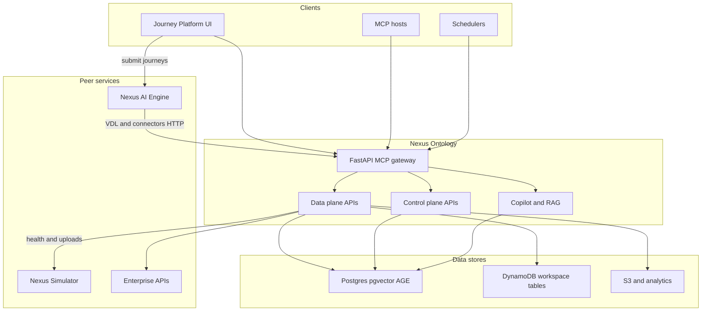

# Nexus Ontology

**Nexus Ontology** is the enterprise **data + control plane** for the Nexus
platform. It exposes virtual enterprise data (VDL), mapping and connector APIs,
ontology and knowledge graph tooling, copilot-style reasoning in the UI, and
packaged solutions—while **production journey execution** runs in
[**nexus-ai-engine**](../nexus-ai-engine) and **enterprise simulators** run in
[**nexus-simulator**](../nexus-simulator).

Monorepo: **FastAPI backend** (`mcp_http_gateway.py`) + **React Journey
Platform UI** (Vite), deployed via [`nexus-deployer/kube-operator`](../nexus-deployer/kube-operator).

Deeper backend narrative:
[`backend/doc/control-plane/Total-system-architecture.md`](backend/doc/control-plane/Total-system-architecture.md)
· UI design system:
[`frontend/doc/design-system/README.md`](frontend/doc/design-system/README.md).

---

## Business overview

Organizations want AI on top of Salesforce, SAP, telco BSS, files, and
warehouses **without** giving models raw database credentials or ungoverned API
access. Nexus Ontology is where teams:

- **Model** the business (entities, mappings, policies, knowledge graph).
- **Connect** sources (FDW, connectors, uploads, streams).
- **Query** through a **Virtual Data Layer** by business names—not ad hoc SQL
  in every app.
- **Design** automation and copilot experiences that **submit** work to the AI
  Engine for durable, governed execution.

| Persona | Primary surfaces |
|--------|-------------------|
| **Data / integration engineer** | Data Plane — sources, mapping rules, runtime explorer, pipelines |
| **Ontology / solution architect** | Control Plane — entity explorer, knowledge graph, policies |
| **Business operator** | Solutions, AI Analytics, Journey Studio / automation (with AI Engine runs) |
| **Platform / SRE** | Operations — diagnostics, health, simulator landing, settings |

---

## Why it exists

Nexus Ontology was consolidated from the historical **nexus-backend** and
**nexus-ui** repos to:

1. **Separate concerns** — Ontology holds schema, mappings, credentials routing,
   and copilot **planning** context; AI Engine holds **tool execution** and
   journey workers ([AI Engine boundaries](../nexus-ai-engine/docs/spec/041-ontology-data-plane-api.md)).
2. **Unify the operator experience** — one SPA for AI Stack, workspace apps,
   analytics, and operations (see [`navigation.ts`](frontend/src/config/navigation.ts)).
3. **Standardize multi-tenant resource naming** —
   `{capability}-{environment}-{purpose}` (e.g. `ontology-local-foundry-workspace`
   on local K3s).
4. **Integrate safely with simulators** — Ontology is a **remote-only** consumer
   of **nexus-simulator** (no in-process simulator fallback).

---

## How you use it (platform map)

The UI is organized into planes that mirror how the backend is structured:

```text
AI Stack
  Home            — platform overview
  Data Plane      — register sources, VDL queries, mapping rules, FDW explorer
  Control Plane   — ontology, knowledge graph, semantic / policy context
  Reasoning       — copilot workspace, tools catalogue, playgrounds

Workspace
  Solutions       — packaged domain apps (widgets, alerts)
  AI Analytics    — dashboards, views, builders
  AI Automation   — journeys, copilot-saved flows (execution → AI Engine)

AI Ops
  Diagnostics     — per-solution and subsystem checks (incl. simulator health)
  Health          — monitoring, jobs, audit signals
  Enterprise Simulator — landing page → external nexus-simulator UI

Settings / Help — auth, license, users; in-product help and design-system routes
```

Typical **read path**: user or copilot asks a business question → RAG /
ontology context → optional **ReAct planning** in control plane → tool calls
that ultimately use **VDL** or **Connector** HTTP APIs exposed by this
service.

Typical **automation path**: author or import a journey in the UI →
**submit execution** to **Nexus AI Engine** → monitor runs via engine API/SSE
(Ontology does not replace the engine worker fleet).

---

## Relationship to Nexus AI Engine and simulator

| Service | Role |
|---------|------|
| **Nexus Ontology** (this repo) | VDL, mapping rules, connectors, graph/RAG, MCP gateway, operator UI |
| **Nexus AI Engine** | Journey DSL storage (engine-owned), execution graph, workers, tool packages |
| **Nexus Simulator** | Realistic enterprise APIs/files for test and demos (`SIMULATOR_*` URLs) |

Configure simulator endpoints in backend env and
[`/api/v1/config/simulator`](frontend/src/services/simulatorLink.ts); the UI
routes operators through [`/simulator`](frontend/src/pages/SimulatorPage.tsx)
before opening the external simulator UI.

---

## Architecture

```text
         Operators · Copilot · MCP clients · Schedulers
                              │
                              ▼
┌──────────────── Nexus Ontology (this repo) ─────────────────┐
│  React UI (Journey Platform)  ──REST/SSE──►  FastAPI gateway │
│       │                                        │              │
│       │    ┌─────────────── AI Stack ─────────┼──────────┐  │
│       │    │ Data Plane    Control Plane   Reasoning     │  │
│       │    │ VDL · FDW     Ontology · KG    Copilot/RAG  │  │
│       │    │ Mapping       Policies         MCP tools   │  │
│       └───►│ Connectors    Plugins/Solutions            │  │
│            └──────────────────┬───────────────────────────┘  │
│                               │ Postgres · Redis · DDB · S3 │
└───────────────────────────────┼────────────────────────────┘
                                │
          ┌─────────────────────┼─────────────────────┐
          ▼                     ▼                     ▼
   External systems      Nexus AI Engine        Nexus Simulator
   (SFDC, SAP, …)        (journey execution)     (test enterprise)
```

<details>
<summary>Mermaid (GitHub / viewers that support diagram blocks)</summary>



</details>

Control-plane reference diagrams (ASCII):
[`backend/doc/control-plane/architecture.md`](backend/doc/control-plane/architecture.md).

---

## Current state

| Area | Status |
|------|--------|
| **Backend API** (`backend/VERSION`, e.g. `0.1.18`) | Production path via `mcp_http_gateway.py`; VDL, mapping rules, plugins, MCP, license, diagnostics |
| **Frontend** | Nexus design system UI (Geist, `components/ds`); AI Stack / Workspace / AI Ops navigation |
| **Virtual Data Layer** | `VirtualQueryService`, mapping rule APIs, canonical seeders (e.g. supply-chain / SFDC schemas) |
| **FDW / runtime explorer** | Foreign data wrapper tooling for governed query paths |
| **Enterprise simulator** | Remote **nexus-simulator** only; in-app landing + diagnostics |
| **Journey execution at scale** | Submitted to **nexus-ai-engine**; legacy transformation paths still present during migration |
| **Deploy** | `ontology-{env}` on EKS; `ontology-local` on K3s via `deploy/deploy-app-changes.sh` |

Repo root `VERSION` tracks the release bundle; image tags follow
`nexus-ontology-api` / `nexus-ontology-ui` from kube-operator.

---

## Repository layout

```
nexus-ontology/
├── backend/                 # FastAPI + MCP + enterprise-knowledge
│   ├── mcp_http_gateway.py  # Main API entrypoint
│   ├── src/                 # Services, APIs, plugins, VDL, journeys (legacy)
│   ├── enterprise-knowledge/# Domain tools, ontology assets
│   └── doc/control-plane/   # Architecture and ReAct layer docs
├── frontend/                # React + Vite operator UI
│   ├── src/                 # Pages, data/control plane components, ds/
│   └── doc/design-system/   # UI rules and screen patterns
├── deploy/
│   ├── k8s/                 # Kubernetes manifests
│   └── deploy-app-changes.sh# Fast path: build + local/EKS rollout
├── scripts/                 # K3s port-forward, postgres extensions, verify
├── VERSION
└── Makefile                 # dev-backend, dev-frontend, deploy-dev, smoke
```

---

## Local development (simple)

```bash
# Backend (use a venv in practice — see Makefile)
cd backend && pip install -r requirements.txt
python mcp_http_gateway.py

# Frontend
cd frontend && npm ci && npm run dev
```

Prefer [`make dev-backend`](#k3s-backed-local-dev-recommended) when you need
real DynamoDB, MinIO, and Postgres from K3s.

---

## K3s-backed local dev (recommended)

Run backend and frontend on the host with hot reload, connected to the K3s local
stack (Scylla/MiniStack/MinIO/Redis + operator-managed Postgres/Mimir). No
Docker image rebuild for app code changes.

### Prerequisites

1. K3s cluster and local AWS stack (from `nexus-deployer`):

```bash
cd ../nexus-deployer/aws-login && ./set-context.sh 6
cd ../nexus-deployer/kube-operator
./operator.sh deploy
cd ../local-k3s
./deploy-local-aws-stack.sh --kube-context local-cluster
./tests/verify-local-stack.sh --kube-context local-cluster
./tests/verify-local-boto3-apis.sh --kube-context local-cluster
```

2. Deploy ontology dev dependencies (postgres + Mimir only; no app pods):

```bash
# Required — use local K3s kubeconfig (not default ~/.kube EKS contexts)
source ../aws-login/.active-env
# Or: export KUBECONFIG=/path/to/nexus-deployer/aws-login/.kube/config

kubectl --context local-cluster apply -f examples/nexus-ontology-local-dev-deps.yaml
kubectl --context local-cluster wait -n ontology-local statefulset/pgvector --for=condition=ready --timeout=300s
```

If you see `the server has asked for the client to provide credentials`, kubectl is pointed at EKS instead of local K3s — run `source ../aws-login/.active-env` or `./set-context.sh 6` first.

3. Initialize postgres extensions (pgvector tables; AGE if image supports it):

```bash
cd ../../nexus-ontology
./scripts/init-postgres-extensions.sh
```

4. (Optional) Seed local DynamoDB/S3 names for ontology:

```bash
make init-k3s-local-aws
```

### Daily workflow

```bash
# Terminal 1 — port-forwards (auto-started by make dev-backend if missing)
make port-forward-k3s

# Terminal 2 — backend (ensures K3s port-forwards + verifies DDB/MiniStack/MinIO/Redis)
cp backend/.env.local.k3s.example backend/.env.local   # once
make dev-backend   # uses .venv + unsets AWS_PROFILE

# Terminal 3 — frontend (start backend first)
cp frontend/.env.local.k3s.example frontend/.env.local   # once
make dev-frontend
```

| Service | Host endpoint |
|---------|---------------|
| Backend API | http://localhost:8000 |
| Frontend UI | http://localhost:5173 (dev) / `:8080` (prod build) |
| DynamoDB (Scylla) | http://127.0.0.1:8001 |
| Athena/Glue (MiniStack) | http://127.0.0.1:4566 |
| S3 (MinIO) | http://127.0.0.1:9000 |
| Redis | redis://127.0.0.1:6379 |
| Postgres | 127.0.0.1:5432 |
| Mimir | http://127.0.0.1:9090 |

Stop port-forwards: `make stop-port-forward-k3s` or `./scripts/stop-port-forward-k3s-dev.sh`

**Important:** Do not reuse `backend/.env.local` for K3s dev — it may point at prod tables. Use `backend/.env.local.k3s.example` (`CAPABILITY_NAME=ontology`, `ENVIRONMENT=local`).

**Frontend + backend:** Start the backend first (`make dev-backend`), then the frontend (`make dev-frontend`). The frontend needs `http://localhost:8000` reachable. `make dev-frontend-setup` copies `public/config.local.json` → `public/config.json` and `.env.local.k3s.example` → `.env.local` if missing.

**Resource naming:** DynamoDB tables and most AWS resources follow `{capability}-{environment}-{purpose}`. Local K3s uses `ENVIRONMENT=local` (e.g. `ontology-local-foundry-workspace`); remote K8 uses `dev`/`prod` (e.g. `ontology-dev-foundry-workspace`). Set only `CAPABILITY_NAME` and `ENVIRONMENT` — do not hardcode table names unless overriding a single resource. The local init job (`make init-k3s-local-aws`) creates the same names Scylla-side.

### Apache AGE (optional, full graph RAG)

The default `pgvector/pgvector:pg16` image supports vector search; `GraphStore` falls back to metadata-based graph expansion without AGE. For full Cypher graph traversal, use a postgres image with Apache AGE (e.g. `nexus-sre-postgres`) in `nexus-ontology-local-dev-deps.yaml`, then re-run `./scripts/init-postgres-extensions.sh`.

### Simulator configuration

Ontology is a **remote-only** consumer of **nexus-simulator**. Set
`SIMULATOR_BASE_URL` (in-cluster DNS) and `SIMULATOR_UI_URL` (browser deep-link;
`http://localhost:8082` locally). There is no in-process simulator fallback.

---

## Deploy (kube-operator)

From this repo (recommended):

```bash
./deploy/deploy-app-changes.sh --env local          # K3s: build, import, rollout
./deploy/deploy-app-changes.sh --env dev --dry-run  # plan for EKS dev
```

Or manual operator steps:

```bash
cd ../nexus-deployer/kube-operator
./bump-version.sh ontology-all patch --ontology-dir ../../nexus-ontology
./package-images.sh --only-ontology-images --ontology-dir ../../nexus-ontology
./create-ecr-images.sh --only-ontology-images
./app-rollout.sh --capability ontology --env dev --version <tag> ontology-all
```

Shortcut:

```bash
make deploy-dev    # package + push + apply-k8s + rollout (EKS dev path)
make smoke         # in-cluster health checks when pods are running
```

---

## Images

| Component | ECR repository | K8s deployment |
|-----------|----------------|----------------|
| API | `nexus-ontology-api` | `nexus-ontology` / `ontology-local-backend` |
| UI | `nexus-ontology-ui` | `nexus-ontology-ui` / `ontology-local-frontend` |

Namespace: `ontology-{env}` (e.g. `ontology-dev`, `ontology-prod`; local K3s uses `ontology-local`).

---

## Documentation map

| Topic | Location |
|-------|----------|
| Control plane & ReAct | [`backend/doc/control-plane/`](backend/doc/control-plane/) |
| Backend runbook | [`backend/README.md`](backend/README.md) |
| UI design system | [`frontend/doc/design-system/README.md`](frontend/doc/design-system/README.md) |
| UI ↔ API wiring | [`frontend/doc/backend-connect/README.md`](frontend/doc/backend-connect/README.md) |
| Auth / RBAC | [`frontend/doc/auth-rbac/README.md`](frontend/doc/auth-rbac/README.md) |
| K8s deployment notes | [`frontend/doc/KUBERNETES-DEPLOYMENT.md`](frontend/doc/KUBERNETES-DEPLOYMENT.md) |
| AI Engine (execution) | [`../nexus-ai-engine/README.md`](../nexus-ai-engine/README.md) |

---

## License

See repository license terms from Nexus Data AI (if `LICENSE` is present at repo root).
