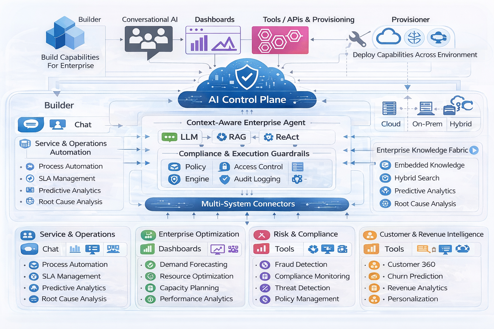

Great question — what you’re observing in Cursor (or similar AI coding agents) is not just “a model generating code,” but an **agentic execution loop** built around the model.

Let me break the full process down clearly and technically.

---

# 1️⃣ High-Level Architecture

When you ask Claude in Cursor to “implement X” or “fix Y,” the system typically consists of:

```
User Prompt
     ↓
Context Builder (Code Index + Retrieval)
     ↓
LLM (Claude) → Action Plan
     ↓
Tool Executor (terminal, file edits, search, tests)
     ↓
Result Feedback
     ↓
LLM (decides next action)
     ↓
Loop until done
```

This is called an **agent loop** or **ReAct-style planning loop** (Reason + Act).

The model is not “running commands.”
It is **deciding which tool to call next**, and the host environment executes them.

---

# 2️⃣ Step 1: Code Context Construction

Before the model acts, the system constructs a **working context**.

### How this works:

### A. Code Indexing

Cursor likely:

* Parses the entire repo
* Builds embeddings for files/functions/classes
* Stores them in a vector index

This enables:

```
semantic search("where is auth implemented?")
```

Instead of dumping the whole repo into the prompt (impossible due to token limits).

---

### B. Relevant Context Retrieval

When you ask:

> “Add JWT auth to this backend”

The system:

1. Extracts intent from your prompt
2. Searches the vector index
3. Retrieves relevant:

   * Auth files
   * Server setup
   * Middleware
   * Config
4. Adds them into Claude’s prompt

So Claude sees something like:

```
User request: Add JWT auth

Relevant files:
- server.ts
- auth.ts
- routes/user.ts
- package.json
```

This is **RAG (Retrieval-Augmented Generation)**.

---

# 3️⃣ Step 2: The Agent Planning Mechanism

Now Claude doesn’t just output code.

Instead, it outputs something structured like:

```
Thought: I need to inspect auth.ts
Action: open_file("auth.ts")
```

Or:

```
Thought: Tests may fail, run them first.
Action: run_terminal("npm test")
```

This is based on a technique called:

> ReAct (Reasoning + Acting)

The model alternates between:

* **Reasoning step**
* **Tool selection**
* **Observation of result**

---

# 4️⃣ The Tool Execution Layer

Cursor provides Claude with available tools, such as:

```
open_file(path)
edit_file(path, patch)
search_code(query)
run_terminal(command)
run_tests()
```

Claude does not execute them directly.

Instead it outputs structured JSON like:

```json
{
  "tool": "run_terminal",
  "args": {
    "command": "npm test"
  }
}
```

Cursor:

* Executes command
* Captures stdout/stderr
* Feeds result back to Claude

---

# 5️⃣ The Feedback Loop

After execution:

Claude receives:

```
Observation:
Test failed:
TypeError: user is undefined at auth.ts:45
```

Then Claude reasons again:

```
Thought: The error indicates missing null check.
Action: edit_file("auth.ts", patch=...)
```

This continues until:

* Tests pass
* Errors resolved
* Goal achieved

This is called:

> Iterative Self-Correction Loop

---

# 6️⃣ Why It Feels “Autonomous”

Because the loop looks like this:

```
PLAN → EXECUTE → OBSERVE → REPLAN → EXECUTE → OBSERVE
```

Repeated multiple times in a single interaction.

It mimics how a human developer works:

1. Inspect code
2. Make change
3. Run tests
4. Debug
5. Repeat

---

# 7️⃣ How the Model Decides the Next Command

Claude is trained to:

* Understand programming workflows
* Predict debugging steps
* Infer dependencies
* Recognize error messages

Given:

```
Error: Module not found: bcrypt
```

It has learned typical resolution patterns:

* Install package
* Update import
* Fix path

So it generates:

```
run_terminal("npm install bcrypt")
```

This behavior emerges from:

* Massive training on GitHub
* Exposure to debugging patterns
* Fine-tuning for tool usage

---

# 8️⃣ The Core Mechanism: It's Just Next-Token Prediction

Very important:

Claude is not truly “thinking.”

It predicts the most likely next token sequence based on:

```
Current Prompt + Retrieved Code + Tool Output + System Instructions
```

Because the system prompt says:

> “You are an agent. You can use tools. Decide next action.”

It behaves like one.

---

# 9️⃣ Under the Hood: Technical Pattern

The implementation usually follows:

### Pseudocode

```python
while not done:
    context = build_context(user_request, repo_state, previous_actions)
    
    response = LLM(context)
    
    if response.contains_tool_call():
        result = execute_tool(response.tool)
        append_to_context(result)
    else:
        done = True
        return response
```

This loop may run:

* 5 times
* 20 times
* Until a max step limit

---

# 🔟 Why Context Formation Is Critical

The real intelligence is not just the LLM.

It’s:

* Smart retrieval
* Context compression
* Tool selection constraints
* Step budgeting

Without this:

* Token explosion
* Hallucinated edits
* Random command loops

---

# 1️⃣1️⃣ Advanced Capabilities in Cursor

Modern AI coding agents also use:

### ✔ File Diff Awareness

Only sending changed lines instead of whole file.

### ✔ Tree-of-Thought Planning

Sometimes model generates a high-level plan first.

### ✔ Error Classification

Before retrying, it categorizes failure type.

### ✔ Safeguards

* Command allowlists
* Timeout limits
* Max iterations

---

# 1️⃣2️⃣ What This Is Called Architecturally

This pattern is known as:

* Agentic LLM
* Tool-augmented LLM
* ReAct Agent
* Autonomous Code Agent
* Execution-aware LLM

Frameworks that implement this:

* LangChain Agents
* OpenAI Assistants
* AutoGPT
* Devin-like systems
* Cursor’s proprietary orchestrator

---

# 1️⃣3️⃣ Why This Works So Well for Code

Code is ideal because:

* Deterministic feedback (tests pass or fail)
* Compiler errors are structured
* Stack traces are informative
* Environment is executable

This makes iterative correction possible.

In contrast:

* Essay writing has no objective “pass/fail”
* Architecture design is ambiguous

---

# 1️⃣4️⃣ The Most Important Insight

The power is not Claude alone.

It’s:

> LLM + Tools + Retrieval + Execution Loop + Feedback

Without execution feedback, it would just generate static code.

---

# 1️⃣5️⃣ If You Want to Build This Yourself

You need:

1. Repo parser
2. Embedding search index
3. Tool execution sandbox
4. Loop controller
5. LLM with tool-calling capability
6. Guardrails

I can also explain how to build a minimal version of this agent if you want.

---

# Final Summary

What you’re seeing in Cursor is:

* Context-aware retrieval (RAG)
* Agent-style reasoning (ReAct)
* Structured tool calling
* Execution feedback loop
* Iterative self-correction
* Bounded autonomy

It feels like it “thinks and runs commands,”
but it is actually predicting the next best action step-by-step based on context.

---

If you want, I can next explain:

* How memory works across sessions
* How multi-file refactoring planning works
* How it avoids infinite loops
* Or how to architect such a system at scale

Just tell me which direction you want to go.

Yes — not only can you do that, that is exactly where enterprise AI agents are heading.

What you’re describing is:

> A multi-system, context-aware, guarded enterprise agent
> using RAG + ReAct + system-specific tool adapters.

This is completely feasible — but the architecture must be designed carefully.

Let me break this down properly.

---

# 1️⃣ What You’re Proposing

You want:

* Context-aware understanding of:

  * Salesforce
  * Oracle ERP
  * Possibly other enterprise systems
* Ability to:

  * Query them
  * Modify records
  * Trigger workflows
* Using:

  * RAG (to understand schema/process)
  * ReAct (plan → execute → observe → replan)
* With:

  * Guardrails (so it doesn’t break production)

That’s essentially an:

> Enterprise System Orchestrator Agent

---

# 2️⃣ High-Level Architecture

Here’s the reference architecture:

```
User Intent
    ↓
Intent Analyzer
    ↓
Enterprise Context RAG Layer
    ↓
ReAct Agent (LLM)
    ↓
System Tool Abstraction Layer
    ↓
Salesforce | Oracle ERP | Others
    ↓
Result Feedback
    ↓
LLM Replans
```

Let’s break each layer.

---

# 3️⃣ Context-Aware RAG for Enterprise Systems

You don’t embed raw data.

You embed:

### A. Metadata

* Salesforce object schema
* Field descriptions
* Custom object definitions
* Oracle ERP module definitions
* API specifications

### B. Process Documentation

* Approval workflows
* Business rules
* Data relationships
* Naming conventions

### C. Change Policies

* Which objects are writable
* Required approval rules
* Compliance constraints

---

### Example

User asks:

> Increase credit limit of customer ABC by 20%

The RAG layer retrieves:

* Salesforce object: Account
* Field: Credit_Limit__c
* Rule: Change >10% requires approval workflow
* Integration dependency: Oracle AR sync

So the LLM doesn’t guess — it sees enterprise constraints.

---

# 4️⃣ Tool Abstraction Layer (Critical)

Never let the LLM call raw APIs.

Instead define controlled tools like:

```
get_salesforce_account(id)
update_salesforce_account(id, fields)
run_oracle_ar_query(sql_id)
submit_credit_limit_change_request(...)
```

These tools enforce:

* Field-level access control
* Validation
* Change thresholds
* Logging
* Rate limiting
* Sandbox vs production routing

The LLM chooses the tool —
but your backend enforces safety.

---

# 5️⃣ ReAct Loop in Enterprise Context

Here’s how it works:

### Step 1 — Plan

LLM:

```
Thought: Need to retrieve account ABC.
Action: get_salesforce_account("ABC")
```

### Step 2 — Observe

Tool returns:

```
Credit limit = 100,000
Customer risk tier = Medium
```

### Step 3 — Reason

LLM:

```
20% increase = 120,000
Policy says >10% requires approval.
```

### Step 4 — Safe Action

Instead of direct update:

```
Action: submit_credit_limit_change_request(...)
```

That’s policy-aware autonomy.

---

# 6️⃣ Guardrails (Non-Negotiable)

In enterprise systems, guardrails are more important than intelligence.

You need multiple layers:

---

## 🔐 1. Permission Guardrails

User-level RBAC:

* Finance user → can request
* Admin → can approve
* Agent → cannot override approval

---

## 📜 2. Policy Engine

Before executing any change:

```
policy_engine.validate(action)
```

Example:

* Max credit increase = 10% without approval
* No updates during financial close window

---

## 🧠 3. Intent Risk Classification

LLM first classifies intent:

* Read-only
* Low-risk write
* High-risk write
* Cross-system change

High-risk actions:

* Require confirmation
* Require human approval
* Or force sandbox mode

---

## 🧪 4. Dry-Run Mode

Before executing:

Agent simulates:

```
Proposed change:
Credit limit 100k → 120k
Impact: triggers approval workflow
Sync to Oracle AR
```

User must confirm.

---

## 🧾 5. Full Audit Logging

Every action:

* Intent
* Tool call
* Result
* User identity
* Timestamp
* Before/after state

This is mandatory for compliance.

---

# 7️⃣ Multi-System Orchestration

When multiple systems are involved:

Example:

> Create customer in Salesforce and sync to Oracle ERP.

Agent flow:

1. Validate customer data
2. Create in Salesforce
3. Capture SF ID
4. Create matching record in Oracle
5. Validate sync status
6. Rollback if failure

You must support:

* Transaction management
* Compensating actions
* Idempotency keys

This is no longer “LLM tool use.”

This becomes:

> AI-Orchestrated Enterprise Integration Layer

---

# 8️⃣ Architecture Pattern You’d Implement

This is the clean pattern:

```
┌──────────────────────┐
│     User Interface    │
└──────────┬───────────┘
           ↓
┌──────────────────────┐
│ Intent + Risk Class. │
└──────────┬───────────┘
           ↓
┌──────────────────────┐
│ Enterprise RAG Layer │
└──────────┬───────────┘
           ↓
┌──────────────────────┐
│  ReAct LLM Planner   │
└──────────┬───────────┘
           ↓
┌──────────────────────┐
│ Tool Control Layer   │
│ (Guardrails + Policy)│
└──────────┬───────────┘
           ↓
┌──────────────────────┐
│ System Adapters      │
│ SF | Oracle | SAP    │
└──────────────────────┘
```

---

# 9️⃣ Challenges You Must Solve

This is where most implementations fail.

---

## ❌ Problem 1: Schema Drift

Salesforce org changes → embeddings outdated.

Solution:

* Scheduled metadata re-indexing
* Version-aware embeddings

---

## ❌ Problem 2: Hallucinated Fields

LLM tries to update non-existent fields.

Solution:

* Tool layer rejects unknown fields
* LLM re-plans based on real schema

---

## ❌ Problem 3: Dangerous Free-Form SQL

Never allow LLM to write raw SQL to ERP.

Instead:

* Predefined parameterized queries only
* Or GraphQL-like abstraction

---

## ❌ Problem 4: Infinite Action Loops

Add:

* Max step limit
* Loop detection
* Action diversity tracking

---

# 🔟 Should You Use Single or Multi-Agent?

For enterprise:

Better approach:

* **Intent Agent**
* **Planning Agent**
* **Execution Agent**
* **Compliance Agent**

Rather than one giant LLM loop.

This increases reliability significantly.

---

# 1️⃣1️⃣ Is This Production-Ready Today?

Yes — but only if:

* You treat LLM as planner, not executor
* You enforce strong API boundaries
* You include policy engine
* You log everything
* You require confirmation for risky writes

Without guardrails, this is dangerous.

With guardrails, it’s extremely powerful.

---

# 1️⃣2️⃣ What This Becomes Strategically

This evolves into:

> Enterprise AI Control Plane

Instead of employees:

* Logging into 5 systems
* Clicking through forms

They issue structured intent:

“Extend credit for high-value customer with justification.”

Agent:

* Understands policy
* Navigates systems
* Executes safely

---

# Final Answer

Yes — you can absolutely implement:

* Context-aware RAG for Salesforce & Oracle
* ReAct-based planning
* Controlled tool execution
* Enterprise-grade guardrails

But the critical design principle is:

> LLM decides
> Backend enforces

Never the other way around.

---

If you’d like, I can next:

* Design a reference production architecture
* Show sample tool definitions
* Show policy-engine integration
* Or walk through a real enterprise use case end-to-end

Which direction would you like?

Excellent — let’s design this as a **production-grade Enterprise AI Orchestrator** that can safely operate across systems like Salesforce and Oracle ERP using:

* Context-aware RAG
* ReAct-style planning
* Strict guardrails
* Enterprise-grade governance

This will be a real reference architecture — not a toy demo.

---

# 🎯 Design Goals

1. Cross-system context awareness (Salesforce + Oracle ERP)
2. Safe read & write capability
3. Policy-enforced execution
4. Full auditability
5. Human-in-the-loop for high-risk changes
6. Scalable and modular
7. Zero direct LLM access to production APIs

---

# 1️⃣ High-Level Production Architecture

```
                         ┌─────────────────────────┐
                         │       User Interface     │
                         │  (Chat / API / Copilot)  │
                         └────────────┬────────────┘
                                      ↓
                         ┌─────────────────────────┐
                         │ Identity & RBAC Layer   │
                         │ (SSO, OAuth, SCIM)      │
                         └────────────┬────────────┘
                                      ↓
                         ┌─────────────────────────┐
                         │ Intent + Risk Analyzer  │
                         │ (LLM or small model)    │
                         └────────────┬────────────┘
                                      ↓
                         ┌─────────────────────────┐
                         │ Enterprise RAG Layer    │
                         │ (Metadata + Policies)   │
                         └────────────┬────────────┘
                                      ↓
                         ┌─────────────────────────┐
                         │ ReAct Planning Engine   │
                         │ (LLM Agent Loop)        │
                         └────────────┬────────────┘
                                      ↓
                         ┌─────────────────────────┐
                         │ Policy & Guardrail Core │
                         │ (OPA / Custom Engine)   │
                         └────────────┬────────────┘
                                      ↓
                         ┌─────────────────────────┐
                         │ Tool Abstraction Layer  │
                         │ (Controlled APIs)       │
                         └────────────┬────────────┘
                                      ↓
         ┌──────────────────────┬────────────────────────┐
         ↓                      ↓                        ↓
┌────────────────┐     ┌────────────────┐        ┌────────────────┐
│ Salesforce API │     │ Oracle ERP API │        │ Other Systems  │
└────────────────┘     └────────────────┘        └────────────────┘
```

---

# 2️⃣ Core Architectural Components

---

# A. Identity & Access Layer

### Responsibilities:

* SSO integration (Okta/Azure AD)
* Role-based access
* System-level credentials mapping
* Tenant isolation

Key rule:

> LLM never decides permissions — identity service does.

Each request carries:

```
user_id
roles
department
environment (prod/sandbox)
```

---

# B. Intent & Risk Analyzer

Before planning, classify:

* Read-only
* Low-risk write
* High-risk write
* Cross-system transaction
* Financial-impacting change

High-risk → mandatory approval workflow

This prevents unsafe planning early.

---

# C. Enterprise RAG Layer

This is not data RAG.

It is **Metadata + Policy + Process RAG**

## Indexed Content

### Salesforce

* Object schemas
* Field metadata
* Validation rules
* Workflow definitions

### Oracle ERP

* Module structure
* Financial rules
* GL posting policies
* AR/AP dependencies

### Enterprise

* Compliance rules
* Change policies
* Close window rules
* Integration mappings

---

### Retrieval Strategy

When user says:

> Increase credit limit for ACME by 25%

RAG retrieves:

* Salesforce Account schema
* Credit limit validation rule
* ERP sync policy
* Approval threshold policy

The LLM now plans with real constraints.

---

# D. ReAct Planning Engine

This is the agent loop.

### Loop Pseudocode

```
while not done:
    context = {
        user_intent,
        retrieved_metadata,
        previous_steps,
        tool_results
    }

    response = LLM(context)

    if tool_call:
        validate via Policy Engine
        execute
        append result
    else:
        done
```

Hard limits:

* Max steps = 10
* Max write actions per request = configurable

---

# E. Policy & Guardrail Core (Critical Layer)

This is the most important production component.

Use:

* Open Policy Agent (OPA)
  or
* Custom rule engine

---

## Guardrail Categories

### 1️⃣ Field-Level Guardrails

* Cannot modify financial status directly
* Cannot override approval-required fields

---

### 2️⃣ Risk-Based Guardrails

Example rule:

```
if credit_limit_change > 10%:
    require approval
```

---

### 3️⃣ Time-Based Guardrails

```
if financial_close_window == true:
    block writes
```

---

### 4️⃣ Cross-System Consistency

If Salesforce update requires ERP sync:

* Must use transaction orchestration
* Cannot update only one side

---

# F. Tool Abstraction Layer

This layer is where most architectures fail.

The LLM must NEVER call raw APIs.

Instead, define safe tools:

---

### Salesforce Tools

```
get_account(account_id)
propose_credit_limit_change(account_id, new_value)
create_account(data)
```

---

### Oracle ERP Tools

```
get_ar_balance(customer_id)
create_customer_record(data)
submit_gl_adjustment(request)
```

---

These tools:

* Validate fields
* Enforce policy
* Log actions
* Transform formats
* Mask sensitive data

---

# G. Transaction & Orchestration Engine

For cross-system changes:

Use:

* Saga pattern
* Compensating actions

Example:

```
Step 1: Update Salesforce
Step 2: Update Oracle
If step 2 fails:
    Rollback Salesforce change
```

Never rely on LLM for rollback logic.

---

# H. Human-in-the-Loop Workflow

For high-risk operations:

```
LLM → Proposes Action
↓
Approval Workflow (ServiceNow/Jira/Custom UI)
↓
Approved → Execute
Rejected → Abort
```

Agent pauses until approval event.

---

# I. Observability & Audit

Log everything:

* User intent
* Retrieved context
* LLM reasoning summary
* Tool calls
* Before/after state
* Approval events
* Execution results

Send to:

* SIEM
* Audit DB
* Compliance dashboard

This is essential for SOX compliance.

---

# 3️⃣ Production Safety Patterns

---

## 🧪 1. Sandbox First

Default all writes to sandbox.

Promote to production only after:

* Validation
* Approval
* Confidence scoring

---

## 🛑 2. Deterministic Write Templates

Instead of:

```
update_account(fields)
```

Use:

```
update_credit_limit(account_id, value)
```

Narrow tools reduce hallucination risk.

---

## 🔒 3. Zero Trust LLM

Assume:

* It can hallucinate
* It can misinterpret policy
* It can repeat actions

Guardrail layer must reject invalid actions.

---

## 📊 4. Confidence Scoring

Before execution:

* Score confidence based on:

  * Ambiguity
  * Missing metadata
  * Policy conflicts

Low score → require clarification.

---

# 4️⃣ Deployment Architecture

Recommended:

* Kubernetes-based microservices
* Separate:

  * LLM service
  * RAG service
  * Policy service
  * Tool adapters
* Secrets via Vault
* Network isolation for production connectors

---

# 5️⃣ Scalability Considerations

* Cache metadata embeddings
* Async execution for long workflows
* Event-driven architecture (Kafka)
* Step timeout controls
* Idempotency keys for writes

---

# 6️⃣ What This Becomes

This architecture evolves into:

> Enterprise AI Control Plane

Instead of:

* Humans navigating UI forms

You get:

* Intent-driven system interaction
* Policy-aware automation
* Cross-system orchestration

---

# 7️⃣ Maturity Levels

Level 1 – Read-only enterprise copilot
Level 2 – Guarded write capability
Level 3 – Cross-system transactional orchestration
Level 4 – Autonomous optimization agent
Level 5 – Closed-loop enterprise AI governance

---

# Final Architecture Principle

The single most important rule:

> LLM Plans
> Policy Engine Decides
> Tool Layer Enforces
> Systems Execute

Never allow:

> LLM → Direct System Write

---

If you'd like, next I can:

* Provide a concrete technology stack example (AWS/Azure/GCP version)
* Provide API schema examples for tool definitions
* Design a financial-use-case walkthrough
* Or show how to extend this to telecom BSS/OSS systems

Which direction would you like to go?

Excellent question — this is where many enterprise architectures get confused.

Short answer:

> PostgreSQL Foreign Data Wrapper (FDW) is **not** a replacement for RAG.
> It can be part of your data access layer, but it cannot replace semantic retrieval.

Let’s break this down properly.

---

# 1️⃣ What FDW Actually Does

PostgreSQL FDW allows:

* Querying external systems (Oracle, MySQL, etc.)
* As if they were local PostgreSQL tables

Example:

```sql
SELECT * FROM oracle_customers WHERE credit_limit > 100000;
```

Behind the scenes:

* It connects to Oracle
* Executes remote query
* Returns rows

So FDW gives you:

* Federated SQL access
* Structured data querying
* Cross-database joins

But it is purely relational.

---

# 2️⃣ What RAG Actually Does

RAG (Retrieval-Augmented Generation) provides:

* Semantic search over:

  * Schemas
  * Metadata
  * Policies
  * Documentation
  * API specs
  * Process rules

RAG answers questions like:

* “Which object stores customer credit risk?”
* “What triggers approval workflow?”
* “What fields are required when creating a customer?”
* “What is the ERP sync dependency?”

This is not relational querying.
This is semantic retrieval.

---

# 3️⃣ Where FDW Fails as RAG

Imagine user asks:

> Increase credit limit for high-risk customers but ensure compliance with policy.

To plan correctly, the agent must know:

* What defines high-risk?
* Which field represents risk?
* What approval threshold applies?
* Which system is source of truth?
* What workflow is triggered?

FDW cannot answer that unless:

* You manually encode all policies as structured tables
* And the LLM writes perfect SQL
* And you restrict queries heavily

Even then:

SQL ≠ semantic understanding.

---

# 4️⃣ When FDW Is Useful in This Architecture

FDW is useful for:

## ✔ Structured Data Access Layer

* Unified read access
* Cross-system joins
* Pre-validated query endpoints

For example:

```
get_customer_profile(customer_id)
```

Could internally use FDW to combine:

* Salesforce data
* Oracle AR balance
* Risk score table

That’s good architecture.

---

## ✔ Controlled Query Templates

Instead of allowing LLM to write raw SQL:

You define stored procedures:

```
sp_get_customer_credit_summary(customer_id)
```

Internally:

* Uses FDW
* Uses parameterized queries
* Applies safe filtering

This is excellent for execution layer.

---

# 5️⃣ Why You Still Need RAG

RAG is needed for:

* Schema awareness
* Business rule awareness
* Policy interpretation
* Field descriptions
* Workflow dependencies
* Process documentation

FDW only gives:

```
Rows
Columns
Values
```

RAG gives:

```
Meaning
Constraints
Relationships
Intent mapping
```

---

# 6️⃣ Could You Store Embeddings in PostgreSQL?

Yes — and this is where it gets interesting.

Using:

* pgvector extension

You can:

* Store embeddings in PostgreSQL
* Run vector similarity search
* Combine relational + semantic queries

This means PostgreSQL can host your RAG layer.

But that is:

> PostgreSQL + pgvector = RAG datastore
> Not FDW alone.

---

# 7️⃣ Correct Production Pattern

Best enterprise pattern:

```
                 ┌─────────────────────┐
                 │     LLM Planner     │
                 └─────────┬───────────┘
                           ↓
        ┌────────────────────────────────────┐
        │ Enterprise RAG (pgvector / Pinecone) │
        └─────────┬──────────────────────────┘
                  ↓
        ┌────────────────────────────────────┐
        │ Tool Layer (Stored Procs / APIs)  │
        │ Uses FDW internally if needed     │
        └─────────┬──────────────────────────┘
                  ↓
           Salesforce / Oracle ERP
```

FDW belongs in:

> Data access layer

RAG belongs in:

> Context reasoning layer

They solve different problems.

---

# 8️⃣ Could You Avoid RAG Entirely?

Only if:

* You hard-code every tool
* You eliminate natural language flexibility
* You make the system workflow-driven only

Example:

* "Increase credit limit"
* System uses predefined rule engine
* No LLM reasoning needed

But then:
You don't have an intelligent agent.
You have structured automation.

---

# 9️⃣ Enterprise Reality

In large systems like Salesforce + Oracle ERP:

You absolutely need RAG because:

* Schemas are large
* Custom fields exist
* Policies evolve
* Workflows are complex
* Metadata changes frequently

Without RAG:

* LLM hallucinates fields
* Misses validation rules
* Ignores approval requirements

That becomes dangerous.

---

# 🔟 The Best Hybrid Model

Use:

* PostgreSQL + FDW → Structured execution
* PostgreSQL + pgvector → Semantic RAG
* LLM → Planner
* Policy Engine → Guardrail
* Stored procedures → Safe execution

This gives:

* Deterministic execution
* Semantic awareness
* Enterprise control

---

# Final Verdict

FDW is not a replacement for RAG.

FDW = structured federated data access
RAG = semantic contextual reasoning layer

They serve different architectural purposes.

---

If you'd like, I can next:

* Design a PostgreSQL-based unified RAG + FDW architecture
* Show schema for embedding metadata of Salesforce/Oracle
* Or compare pgvector vs dedicated vector DB for enterprise scale

Which direction do you want to go?

Excellent. This is exactly how you validate whether your **Enterprise Semantic RAG** is production-ready.

You don’t test it by asking generic questions.
You test it by validating whether it retrieves:

* Correct schema elements
* Correct policy constraints
* Correct workflow dependencies
* Correct cross-system impacts
* Correct approval logic

This is **black-box validation** — you don’t inspect embeddings.
You inspect whether the system retrieves the right contextual knowledge to allow safe planning.

---

# 🎯 What Black-Box Testing Must Validate

For Oracle ERP + Salesforce RAG, each test should verify:

1. Correct object identification
2. Correct field-level mapping
3. Correct policy retrieval
4. Correct workflow dependency retrieval
5. Correct cross-system linkage awareness
6. Correct risk/approval thresholds
7. Correct environment restrictions
8. Correct version awareness

---

# 🧪 10 Black-Box Test Scenarios

Each test below contains:

* User Question
* Expected RAG Retrieval (What must be surfaced)
* What Failure Looks Like

---

# ✅ Test 1 — Field Ownership & Source of Truth

### Question:

> Which system is the source of truth for customer credit limit?

### Expected Retrieval:

* Salesforce Account.Credit_Limit__c field
* Policy document stating Salesforce owns credit limit
* Integration mapping showing sync to Oracle AR
* Dependency rule: "Oracle AR balance cannot override credit limit"

### Failure:

* Says Oracle is source of truth
* Doesn’t mention integration mapping
* Misses policy constraints

---

# ✅ Test 2 — Approval Threshold Logic

### Question:

> What happens if I increase a customer's credit limit by more than 15%?

### Expected Retrieval:

* Business rule: >10% requires approval
* Workflow: Credit Limit Approval Flow
* Required approver role
* SLA for approval
* ERP sync condition after approval

### Failure:

* Only retrieves field definition
* Misses approval threshold
* Misses workflow dependency

---

# ✅ Test 3 — Cross-System Dependency Awareness

### Question:

> If I deactivate a customer in Salesforce, what is impacted in Oracle ERP?

### Expected Retrieval:

* Salesforce Account.Status field
* Integration mapping to Oracle AR customer status
* Policy: "Deactivation requires AR balance check"
* Dependency: Cannot deactivate if open invoices exist

### Failure:

* Only retrieves Salesforce field
* Doesn’t mention AR or invoice dependency

---

# ✅ Test 4 — Financial Close Restriction

### Question:

> Can customer credit limits be modified during financial close?

### Expected Retrieval:

* Close window policy document
* ERP restriction rule
* Environment flag: close_period_active
* Compliance rule: SOX constraint

### Failure:

* Says “Yes” without policy context
* Does not retrieve close window restriction

---

# ✅ Test 5 — Field Validation Constraint

### Question:

> What validations apply to the credit limit field?

### Expected Retrieval:

* Field type (currency)
* Max allowed value
* Required justification field
* Approval rule threshold
* Dependency: Risk tier must be evaluated

### Failure:

* Only retrieves field type
* Misses validation and policy constraints

---

# ✅ Test 6 — Workflow Trigger Discovery

### Question:

> What workflows are triggered when a new enterprise customer is created?

### Expected Retrieval:

* Salesforce Account creation workflow
* Risk assessment process
* Oracle ERP customer provisioning
* Credit review process
* Required data enrichment step

### Failure:

* Only retrieves object schema
* Misses workflow chain

---

# ✅ Test 7 — Risk Tier Dependency

### Question:

> How is customer risk tier determined and where is it used?

### Expected Retrieval:

* Field: Risk_Tier__c (Salesforce)
* Risk scoring process documentation
* Policy linking risk tier to credit approval threshold
* ERP AR collection priority rule

### Failure:

* Only retrieves field location
* Misses downstream usage in approval logic

---

# ✅ Test 8 — Schema Drift Awareness

### Question:

> What changed in customer schema in the last release?

### Expected Retrieval:

* Versioned schema metadata
* Newly added fields
* Deprecated fields
* Policy updates referencing new fields

### Failure:

* Returns outdated schema
* No version awareness

---

# ✅ Test 9 — Permission Constraint Awareness

### Question:

> Who is authorized to override customer credit block?

### Expected Retrieval:

* Role definition (Finance Manager)
* Policy override rule
* Audit logging requirement
* Required justification documentation

### Failure:

* Does not retrieve RBAC mapping
* Misses override logging requirement

---

# ✅ Test 10 — Multi-System Transaction Awareness

### Question:

> What steps are required to fully onboard a new B2B customer across systems?

### Expected Retrieval:

* Salesforce account creation schema
* Required fields list
* Oracle ERP customer creation process
* Credit assessment workflow
* Integration dependency mapping
* Sequence constraints
* Failure rollback rule

### Failure:

* Only retrieves Salesforce object
* Misses Oracle provisioning
* Misses process order

---

# 📊 How to Score Black-Box Tests

Each question should be evaluated on:

| Dimension                     | Score |
| ----------------------------- | ----- |
| Correct Object Identified     | 1     |
| Correct Fields Retrieved      | 1     |
| Policy Retrieved              | 1     |
| Workflow Dependency Retrieved | 1     |
| Cross-System Impact Retrieved | 1     |
| Version Correct               | 1     |

Max per test: 6
Production readiness target: ≥ 5 average

---

# 🔎 Advanced Black-Box Test (Edge Case)

### Question:

> Increase ACME's credit limit to 2 million.

RAG must retrieve:

* Current credit limit
* Risk tier
* Approval threshold
* Max allowed limit
* ERP impact
* Financial close restriction

If it only retrieves field name and value — your RAG is shallow.

---

# 🚨 Red Flags in Testing

Your RAG is not enterprise-grade if:

* It retrieves only schema but not policy
* It ignores workflow documentation
* It doesn’t surface cross-system dependencies
* It misses versioned updates
* It retrieves irrelevant objects frequently
* It retrieves too much noise

---

# 🏁 What Good Enterprise Semantic RAG Looks Like

When a question is asked, the retrieval bundle should look like:

```
Primary Object: Salesforce.Account
Relevant Fields: Credit_Limit__c, Risk_Tier__c
Policies: Credit Increase Approval Rule v3.2
Workflow: Credit Approval Flow
ERP Dependency: AR_Customer_Sync
Close Window Restriction: Enabled
```

If retrieval lacks one of these dimensions — planning will be unsafe.

---

# 🧠 Final Insight

Semantic RAG in enterprise is not about answering questions.

It is about enabling safe orchestration decisions.

If retrieval does not surface:

* Constraints
* Dependencies
* Ownership
* Approval requirements

Then your ReAct agent becomes dangerous.

---

If you’d like, next I can:

* Show how to automate this black-box evaluation
* Design a scoring harness
* Show a failure example and how to fix embedding strategy
* Or design a telecom BSS/OSS version of these tests

Which direction do you want to go?

Excellent — now we move from theory to **implementation mechanics**.

You want to see:

> How do we actually index Schema + Business Rules + Policies + Workflows + Dependencies
> into a production-grade semantic RAG for Salesforce + Oracle ERP?

I’ll show you:

1. What to extract
2. How to normalize it
3. How to chunk it
4. How to embed it
5. How to store it
6. How to enable safe retrieval
7. A concrete example

---

# 🎯 Goal

Turn this:

* Salesforce metadata
* Oracle ERP configuration
* Policy documents
* Workflow definitions
* Integration mappings

Into structured semantic retrieval units that support safe planning.

---

# 1️⃣ Step 1 — Define Canonical Knowledge Model

Before indexing anything, define a unified metadata schema.

This is critical.

We do NOT dump raw JSON.

We normalize into a canonical document model:

```json
{
  "id": "SF_ACCOUNT_CREDIT_LIMIT_V3",
  "system": "Salesforce",
  "entity_type": "Field",
  "object_name": "Account",
  "field_name": "Credit_Limit__c",
  "version": "3.2",
  "environment": "prod",
  "category": "Schema | Policy | Workflow | Integration",
  "risk_level": "Medium",
  "content": "... natural language enriched description ...",
  "structured_metadata": {
      "data_type": "Currency",
      "max_value": 1000000,
      "approval_threshold_percent": 10,
      "sync_target": "AR_Customer"
  }
}
```

This is what gets embedded.

---

# 2️⃣ Step 2 — Extract Metadata From Systems

### A. Salesforce

Use:

* Metadata API
* Tooling API

Extract:

* Object definitions
* Field metadata
* Validation rules
* Workflow rules
* Apex triggers
* Flow definitions

---

### B. Oracle ERP

Extract:

* Table schema
* Business rule configuration
* Approval hierarchies
* GL rules
* AR/AP dependencies
* Customizations

---

### C. Enterprise Policy Docs

Parse:

* PDF policies
* Confluence docs
* Compliance documentation
* SOPs

Use document parser → structured text.

---

# 3️⃣ Step 3 — Semantic Enrichment

Raw metadata is not enough.

We enrich it.

Example:

Raw:

```
Field: Credit_Limit__c
Type: Currency(18,2)
Validation Rule: value <= 1000000
```

Enriched document:

```
The Credit Limit field on the Salesforce Account object 
defines the maximum allowable credit exposure for a customer.

Business Rules:
- Maximum allowed value is 1,000,000 USD.
- Increases above 10% require Finance Manager approval.
- Field syncs to Oracle AR_Customer.credit_limit.
- Cannot be modified during financial close window.
- Requires Risk_Tier__c evaluation before update.

Dependent Workflows:
- Credit Approval Flow
- AR Sync Process
```

Now the embedding captures meaning and dependencies.

This is critical.

---

# 4️⃣ Step 4 — Intelligent Chunking Strategy

Never chunk randomly by tokens.

Chunk by semantic unit:

### Good Chunk Types:

* One object + its fields
* One policy rule
* One workflow definition
* One integration mapping

Each chunk should answer:

* What is this?
* What are its constraints?
* What are its dependencies?
* What system owns it?

---

# 5️⃣ Step 5 — Embedding Strategy

For each chunk:

```
embedding = embed(content)
```

Store:

```
vector
+ metadata filters
```

Example metadata columns:

| Column      | Purpose                   |
| ----------- | ------------------------- |
| system      | Salesforce / Oracle       |
| entity_type | Field / Policy / Workflow |
| object_name | Account                   |
| version     | 3.2                       |
| environment | prod/sandbox              |
| risk_level  | high/medium/low           |
| category    | schema/policy/integration |

This enables hybrid filtering.

---

# 6️⃣ Step 6 — Storage Example (Postgres + pgvector)

Example table:

```sql
CREATE TABLE enterprise_rag_index (
    id TEXT PRIMARY KEY,
    system TEXT,
    entity_type TEXT,
    object_name TEXT,
    field_name TEXT,
    category TEXT,
    version TEXT,
    environment TEXT,
    risk_level TEXT,
    content TEXT,
    embedding VECTOR(1536)
);
```

Index:

```sql
CREATE INDEX ON enterprise_rag_index
USING ivfflat (embedding vector_cosine_ops);
```

---

# 7️⃣ Step 7 — Retrieval Mechanism

When user asks:

> Increase credit limit for ACME

Pipeline:

### 1️⃣ Intent Detection

Detect: credit limit change

### 2️⃣ Query Expansion

Expand query:

```
credit limit approval rules validation threshold workflow dependency Oracle sync
```

### 3️⃣ Hybrid Query

```sql
SELECT *
FROM enterprise_rag_index
WHERE system IN ('Salesforce', 'Oracle')
AND category IN ('Schema', 'Policy', 'Workflow', 'Integration')
ORDER BY embedding <-> query_embedding
LIMIT 10;
```

### 4️⃣ Rerank Results

Optional: cross-encoder reranker

---

# 8️⃣ Example End-to-End

Let’s walk a full example.

---

## Input:

> What happens if I increase credit limit by 20%?

---

## Retrieved Chunks:

1️⃣ Salesforce Account.Credit_Limit__c field definition
2️⃣ Policy: >10% requires approval
3️⃣ Workflow: Credit Approval Flow
4️⃣ Integration: Sync to Oracle AR
5️⃣ Close window restriction

---

## Final RAG Context Given to LLM:

```
Field: Credit_Limit__c (Salesforce Account)
- Max value: 1,000,000
- Approval threshold: >10%

Policy:
- Increases above 10% require Finance Manager approval.

Workflow:
- Credit Approval Flow triggered on update.

Integration:
- Syncs to Oracle AR_Customer.credit_limit.

Restriction:
- Modifications blocked during financial close window.
```

Now the agent can safely plan.

---

# 9️⃣ Versioning Mechanism

When Salesforce metadata changes:

1. Detect change (webhook / scheduled sync)
2. Rebuild enriched chunk
3. Increment version
4. Soft-delete old version
5. Re-embed

Never overwrite blindly.

---

# 🔟 Automation Pipeline

Production indexing pipeline looks like:

```
Salesforce Metadata Pull
        ↓
Normalization
        ↓
Semantic Enrichment
        ↓
Chunking
        ↓
Embedding
        ↓
Vector DB Insert
        ↓
Index Refresh
```

Run:

* On deployment
* Nightly
* On metadata change

---

# 1️⃣1️⃣ Common Mistakes

❌ Embedding raw JSON
❌ Chunking by token size
❌ No metadata filters
❌ No versioning
❌ Mixing production + sandbox
❌ Indexing transactional data

---

# 1️⃣2️⃣ Advanced Enhancement (Very Powerful)

Add structured relationships:

```
Account.Credit_Limit__c
   → triggers → Credit Approval Flow
   → syncs_to → AR_Customer.credit_limit
   → constrained_by → Close_Window_Policy
```

Store relationships in graph DB.

Then combine:

* Vector search for semantic match
* Graph traversal for dependency expansion

This gives enterprise-grade reasoning.

---

# 🔐 Production Rule

Semantic RAG must retrieve:

* Object
* Field
* Policy
* Workflow
* Integration dependency

If any of these are missing in retrieval, planning is unsafe.

---

# 🏁 Final Summary

Indexing enterprise semantic RAG requires:

1. Canonical knowledge model
2. Metadata extraction
3. Semantic enrichment
4. Logical chunking
5. Embedding with metadata filters
6. Versioning
7. Hybrid retrieval

It is not “store PDF → embed → done.”

It is a structured knowledge engineering pipeline.

---

If you’d like next, I can:

* Show sample Python code for indexing pipeline
* Show how to implement hybrid search query
* Show how to detect schema drift automatically
* Or design a telecom ODA version of this RAG pipeline

Which direction do you want to go?

Excellent — now we’re moving into **Telecom Open Digital Architecture (ODA)** territory.

Designing a **Telecom ODA Semantic RAG pipeline** is fundamentally more complex than Salesforce/ERP because:

* You have domain decomposition (TMF ODA components)
* You have Open APIs (TMF620, TMF622, TMF641, etc.)
* You have Product–Service–Resource separation
* You have cross-layer orchestration (BSS ↔ OSS)
* You have policy, SLA, and regulatory constraints

So we must design the RAG layer to be:

> ODA-aware, API-aware, domain-aware, and lifecycle-aware.

This will not be a generic RAG.
This will be a **Telecom Knowledge Control Plane**.

---

# 🎯 Objective

Design a production-grade **Semantic RAG pipeline** for:

* Legacy BSS/OSS modernization
* ODA-compliant microservices
* TMF Open API orchestration
* AI-driven service lifecycle management

---

# 1️⃣ What We Are Indexing in Telecom ODA

We do NOT index CDRs or live network telemetry.

We index **knowledge and control-layer metadata**:

---

## A. ODA Component Metadata

* ODA component definitions
* Bounded contexts
* Functional domains (Core Commerce, Production, etc.)
* Component responsibilities
* Event subscriptions

---

## B. TMF Open API Definitions

* API specs (Swagger/OpenAPI)
* Required/optional fields
* Error models
* State models
* Lifecycle transitions

Example:

* TMF620 Product Catalog
* TMF622 Product Ordering
* TMF641 Service Ordering
* TMF638 Service Inventory
* TMF639 Resource Inventory

---

## C. Product–Service–Resource Models

* Product specification
* Service specification
* Resource specification
* Decomposition rules
* Orchestration mappings

---

## D. Business Rules

* Eligibility rules
* Credit control rules
* SLA policies
* Activation constraints
* Regulatory policies

---

## E. Workflow Definitions

* Order orchestration flows
* Activation flows
* Fallout handling
* Retry logic
* Compensation logic

---

## F. Integration Dependencies

* Legacy BSS adapters
* OSS mediation layers
* Network controllers
* Event brokers (Kafka topics)
* Northbound/southbound interfaces

---

# 2️⃣ Canonical Telecom Knowledge Model

We define a normalized knowledge schema:

```json
{
  "id": "TMF622_PRODUCTORDER_STATE_TRANSITION_V1",
  "domain": "Core Commerce",
  "component": "Product Order Management",
  "entity_type": "API | Policy | Workflow | Model | Integration",
  "tmf_api": "TMF622",
  "lifecycle_phase": "Ordering",
  "layer": "BSS | OSS | Cross",
  "version": "4.0",
  "environment": "prod",
  "risk_level": "High | Medium | Low",
  "related_components": ["Service Order Management"],
  "content": "... enriched semantic description ..."
}
```

This ensures ODA-aligned retrieval.

---

# 3️⃣ Example: Enriched TMF622 Indexing

Raw API snippet:

```yaml
state:
  type: string
  enum:
    - acknowledged
    - inProgress
    - completed
    - failed
```

Enriched semantic chunk:

```
TMF622 Product Order State Model (v4.0)

The Product Order lifecycle includes:
- acknowledged
- inProgress
- completed
- failed

Business Rules:
- Transition to inProgress requires successful validation.
- Transition to completed requires all related Service Orders completed.
- If any Service Order fails, Product Order moves to failed.

Dependencies:
- Linked to TMF641 Service Order.
- Emits event on Kafka topic: productOrderStateChange.
- Cannot move to completed if Resource Order pending.

Layer: Core Commerce
Risk Level: High (Customer impacting)
```

Now this is RAG-ready.

---

# 4️⃣ Telecom-Specific Chunking Strategy

Chunk by:

* One TMF API lifecycle model
* One product-to-service decomposition rule
* One orchestration flow
* One SLA policy
* One integration adapter mapping
* One ODA component responsibility definition

Never chunk across lifecycle boundaries.

---

# 5️⃣ Multi-Layer Telecom RAG

Production telecom RAG should have layered indices:

```
Layer 1 — ODA Component Knowledge
Layer 2 — TMF API Definitions
Layer 3 — Product-Service-Resource Models
Layer 4 — Orchestration & Workflow Logic
Layer 5 — Policy & SLA Rules
Layer 6 — Integration & Legacy Mapping
```

Planner retrieves from multiple layers.

---

# 6️⃣ Indexing Pipeline (Telecom Version)

```
1. Extract OpenAPI specs
2. Extract product catalog models
3. Extract service decomposition rules
4. Extract orchestration BPMN flows
5. Extract policy documents
6. Normalize into canonical model
7. Enrich with dependency mapping
8. Chunk by lifecycle unit
9. Embed
10. Store in vector DB with metadata filters
```

---

# 7️⃣ Metadata Fields for Telecom Filtering

| Field           | Purpose                           |
| --------------- | --------------------------------- |
| domain          | Core Commerce / Production        |
| component       | Product Catalog / SOM / Inventory |
| tmf_api         | TMF620 / 622 / 641                |
| lifecycle_phase | Catalog / Ordering / Fulfillment  |
| layer           | BSS / OSS                         |
| risk_level      | SLA impact                        |
| environment     | Prod / Test                       |
| version         | API version                       |

Hybrid search is mandatory.

---

# 8️⃣ Example Retrieval Scenario

User asks:

> What happens if a Product Order fails during activation?

RAG must retrieve:

1. TMF622 state model
2. Dependency to TMF641
3. Orchestration fallback flow
4. Compensation logic
5. Customer notification policy
6. SLA impact rule

If it retrieves only API schema — RAG is insufficient.

---

# 9️⃣ Cross-Layer Dependency Expansion (Advanced)

After vector retrieval:

Perform graph traversal:

```
ProductOrder
   → depends_on → ServiceOrder
   → triggers → ResourceOrder
   → monitored_by → SLA_Policy
   → emits_event → Kafka_Topic
```

Combine:

* Vector retrieval
* Dependency graph expansion

This gives telecom-grade reasoning.

---

# 🔟 Storage Architecture

Recommended:

```
Vector Store: OpenSearch / pgvector
Graph DB: Neo4j (for component dependencies)
Relational DB: PostgreSQL (structured metadata)
Policy Engine: OPA
Event Store: Kafka
```

---

# 1️⃣1️⃣ Schema Drift Handling (Telecom Critical)

Telecom APIs evolve.

Implement:

* Versioned API ingestion
* Diff detection
* Re-embedding on change
* Deprecation tagging
* Backward compatibility marking

Never mix API versions in retrieval without tagging.

---

# 1️⃣2️⃣ Guardrail-Aware Retrieval

Before returning context:

Apply filters:

```
environment = prod
version = latest
layer = relevant
```

If user intent is OSS-related, avoid retrieving BSS-only content.

---

# 1️⃣3️⃣ Example: Full Retrieval Bundle

For:

> Can I cancel a Product Order after Service Order started?

RAG returns:

```
TMF622 cancellation policy
Service Order state dependency
Compensation rule
SLA breach policy
Customer notification requirement
Inventory rollback procedure
```

This enables safe orchestration planning.

---

# 1️⃣4️⃣ Production Safety Rule (Telecom)

RAG must retrieve across:

* Product layer
* Service layer
* Resource layer
* SLA layer
* Integration layer

If any layer is missing → unsafe automation.

---

# 1️⃣5️⃣ What This Enables

With this RAG pipeline, you can:

* Modernize legacy BSS safely
* Build AI order orchestration assistant
* Implement autonomous fulfillment reasoning
* Validate ODA compliance
* Assist API refactoring
* Support AI-driven transformation programs

---

# 🏁 Final Architecture Summary

Telecom ODA Semantic RAG is:

> Structured knowledge engineering
>
> * API-aware enrichment
> * Lifecycle-based chunking
> * Hybrid search
> * Dependency graph expansion
> * Version-aware indexing

It becomes:

> AI Knowledge Backbone for ODA Transformation

---

If you'd like, next I can:

* Design an AI-driven Order Orchestration Agent using this RAG
* Show a legacy-to-ODA transformation example using RAG
* Provide a sample indexing code structure
* Or design governance model for AI in telecom transformation

Which direction do you want to go?

