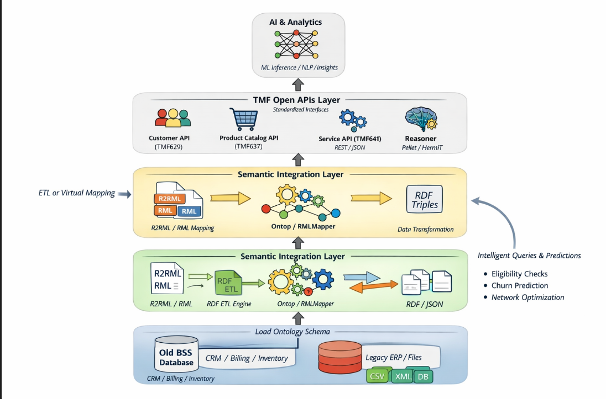

**Title:** End-to-End Flow: Building an Ontology-Driven, TMF-Compliant, AI-Enabled Architecture from a Legacy BSS

---

**1. Legacy BSS Starting Point**
- Monolithic system with relational DBs and SOAP/REST APIs
- Contains core telecom entities: Customer, Product, Subscription, Billing, etc.
- Limited interoperability, no semantic layer, no formal data model alignment with TMF

---

**2. Step 1: Ontology Modeling (Semantic Layer)**
**Goal:** Represent BSS domain concepts semantically using OWL/RDF

**Approach:**
- Analyze legacy DB schemas and WSDLs
- Map tables/entities to OWL Classes (e.g., CUSTOMER -> :Customer)
- Map fields/columns to OWL properties (e.g., BILL_AMT -> :hasBillingAmount)
- Define relationships (e.g., :Customer :hasSubscription :Subscription)
- Align to TM Forum SID or use public ontologies (e.g., FIBO for finance, FOAF for people)

**Tools:**
- Protégé for ontology creation
- RDFLib or D2RQ/R2RML for data transformation

**Output:** Ontology schema (.ttl) + RDF instance data (from DB)

---

**3. Step 2: Data Virtualization or ETL to RDF (Ontology Population)**
**Option A:** Use R2RML/OBDA tools like Ontop to create virtual RDF views over SQL
**Option B:** Extract data to CSV/JSON and convert using RMLMapper or RDFLib scripts

**Output:** RDF triples representing BSS data semantically

---

**4. Step 3: Triple Store and Reasoning Engine**
- Load TBox (ontology schema) + ABox (data instances) into RDF triple store (e.g., GraphDB, Stardog)
- Enable OWL reasoning (Pellet, HermiT)
- Apply domain rules (e.g., infer churn risk, service eligibility)

**Output:** Queryable Knowledge Graph (SPARQL endpoint)

---

**5. Step 4: Expose TMF Open APIs (TMF API Layer)**
**Goal:** Wrap SPARQL queries or triple store access behind TMF RESTful APIs

**Approach:**
- Use OpenAPI specs from TMF (TMF620, TMF637, etc.)
- Implement API facades in Node.js/Java/Python
- Internally translate REST calls to SPARQL (or use GraphQL with SPARQL resolvers)
- Populate TMF API responses from RDF graphs (align API fields with ontology properties)

**Tools:**
- Swagger / Postman for API interface
- SPARQLWrapper, RDFLib, Apache Jena for API backend

**Output:** Standards-based APIs over semantic data

---

**6. Step 5: AI Reasoning and Automation Layer**
**Goal:** Use the ontology graph to power automation, predictions, recommendations

**Capabilities:**
- Use SPARQL + OWL reasoning to detect patterns (e.g., service eligibility, SLA violations)
- Train ML models using graph features (GraphML, RDF2Vec, embeddings)
- Apply reinforcement learning or rule-based agents on inferred graphs
- Implement AI Agents using LLMs to navigate ontology (e.g., "Why is customer C123 not eligible for 5G?")

**Tools:**
- Neo4j/GraphDB for graph queries
- PyKEEN, RDF2Vec, DGL-KE for knowledge embeddings
- LangChain/LLMs for natural language interface over knowledge graphs

---

**7. End Architecture Overview**
```
[Legacy BSS DBs] ---> [R2RML/ETL] ---> [RDF Triples] ---> [Triple Store + Reasoner]
       |                                         |
       |                                         v
       |---> [TMF API Wrappers]          [AI Layer: ML/LLMs over Graph]
```

---

**8. Benefits Realized**
- TMF-compliant modular exposure
- Semantic consistency and AI-readiness
- Zero-copy virtualization over legacy data
- AI explainability via ontology

---

**9. Sample Use Case: Customer Eligibility Check**
1. TMF API call: `GET /customer/{id}/serviceEligibility`    
2. Internally: SPARQL query checks :Customer's :hasSubscription, :hasProduct, :hasBillingHistory against inferred rules (e.g., "Eligible if has 5G plan and no overdue bills")
3. Return: JSON structured as per TMF637
4. AI Layer: If needed, LLM agent can explain eligibility based on graph traversal (e.g., "Customer has 5G plan but had 2 late payments")
