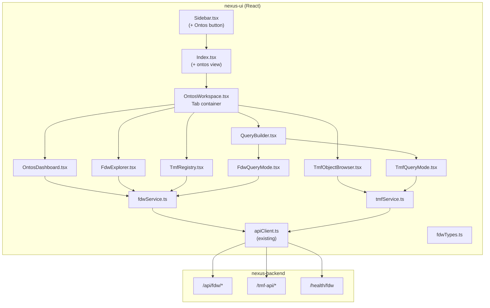
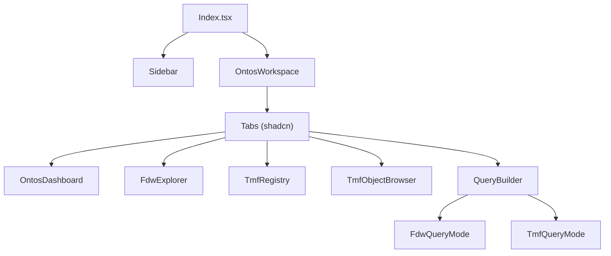
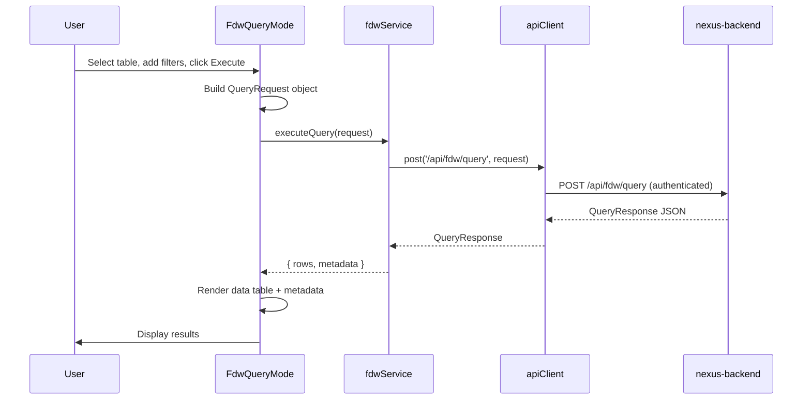

# Design Document: Ontos FDW/TMF UI Integration

## Overview

This design describes how the nexus-ui React application integrates a new "Ontos" workspace for browsing FDW metadata, TMF API standards, TMF object types, and executing queries. The feature adds a sidebar menu item, a tabbed workspace container, five sub-views (Dashboard, FDW Explorer, TMF Registry, TMF Objects, Query Builder), two service modules, and TypeScript type definitions that mirror the backend's Pydantic models.

The implementation follows existing patterns in the codebase:
- Sidebar navigation via `currentView` state in `Index.tsx` (same as `tools` and `ai-workspace`)
- Service modules using the existing `apiClient` for authenticated HTTP requests
- React Query (TanStack Query v5) for server state with appropriate cache keys and stale times
- shadcn/ui + Radix UI primitives for all UI components
- Tailwind CSS with the existing dark mode theme tokens

The design is additive — no existing components are modified beyond adding the Ontos menu item to `Sidebar.tsx` and the Ontos view branch to `Index.tsx`.

## Architecture



### Component Hierarchy



### Data Flow: FDW Query Execution



## Components and Interfaces

### 1. Sidebar Integration (`src/components/Sidebar.tsx` — modified)

Add an `onOntosSelect` callback prop and an "Ontos" button between "AI Workspace" and "Operations".

```typescript
// New prop added to SidebarProps
interface SidebarProps {
  // ... existing props
  onOntosSelect?: () => void;
  currentView?: 'dashboard' | 'tools' | 'ai-workspace' | 'ontos';
}
```

The button follows the exact same pattern as the existing "AI Workspace" and "Tools Catalogue" buttons, using the `Database` icon from `lucide-react`.

### 2. Index Page Integration (`src/pages/Index.tsx` — modified)

Extend the `currentView` state type and add the Ontos rendering branch.

```typescript
const [currentView, setCurrentView] = useState<'dashboard' | 'tools' | 'ai-workspace' | 'ontos'>('dashboard');

const handleOntosSelect = () => {
  setCurrentView('ontos');
};

// In renderMainContent():
if (currentView === 'ontos') {
  return <OntosWorkspace />;
}
```

### 3. OntosWorkspace (`src/components/ontos/OntosWorkspace.tsx`)

Top-level container using shadcn `Tabs` component. Manages the active sub-tab.

```typescript
interface OntosWorkspaceProps {}

// Uses shadcn Tabs with TabsList, TabsTrigger, TabsContent
// Tabs: "dashboard" | "fdw-explorer" | "tmf-registry" | "tmf-objects" | "query-builder"
// Default tab: "dashboard"
// State preserved via React state (not URL)
```

### 4. OntosDashboard (`src/components/ontos/OntosDashboard.tsx`)

Displays health status cards using React Query.

```typescript
// Uses useQuery with key ['fdw', 'health'], refetchInterval: 30000
// Uses useQuery with key ['fdw', 'tmf', 'standards'], staleTime: 600000
// Renders 4 cards: Connection Status, Foreign Servers, Foreign Tables, TMF Standards
// Each card shows a count or status indicator
// Skeleton loaders while loading, error card with retry on failure
```

### 5. FdwExplorer (`src/components/ontos/FdwExplorer.tsx`)

Two-panel layout: server/table list on left, column details on right.

```typescript
// Left panel:
//   - Search input for filtering
//   - Server list (useQuery key ['fdw', 'servers'], staleTime: 300000)
//   - When server selected: table list (useQuery key ['fdw', 'tables', serverName], staleTime: 300000)
// Right panel:
//   - Column table (useQuery key ['fdw', 'columns', schema, table], staleTime: 300000)
//   - Shows: columnName, dataType, isNullable, ordinalPosition
// Refresh button triggers queryClient.invalidateQueries(['fdw', 'servers'])
```

### 6. TmfRegistry (`src/components/ontos/TmfRegistry.tsx`)

Accordion layout showing TMF standards and their resources.

```typescript
// Uses useQuery with key ['fdw', 'tmf', 'standards'], staleTime: 600000
// Renders shadcn Accordion with one item per standard
// Each resource shows: name, HTTP method badges (colored: GET=green, POST=blue, PATCH=yellow, DELETE=red)
// "Query" button on each resource navigates to Query Builder pre-filled
```

### 7. TmfObjectBrowser (`src/components/ontos/TmfObjectBrowser.tsx`)

Searchable type browser with structured and JSON views.

```typescript
// Fetches type definitions from TMF service
// Left: searchable list of type names
// Right: field definition table or raw JSON (toggle)
// $ref fields rendered as clickable links that update the selected type
```

### 8. QueryBuilder (`src/components/ontos/QueryBuilder.tsx`)

Dual-mode query interface using shadcn Tabs for mode switching.

```typescript
// Two tabs: "TMF API" and "FDW Raw Query"
// Delegates to FdwQueryMode and TmfQueryMode sub-components
// Accepts optional pre-fill props (standard, resource) from TMF Registry navigation
```

### 9. FdwQueryMode (`src/components/ontos/FdwQueryMode.tsx`)

FDW raw query form and results display.

```typescript
interface FdwQueryFormState {
  schemaName: string;
  table: string;
  columns: string[];
  filters: Array<{ column: string; operator: FilterOperator; value: string }>;
  orderBy: Array<{ column: string; direction: 'asc' | 'desc' }>;
  limit: number | undefined;
  offset: number | undefined;
}

// Schema/table dropdowns populated from discovery
// Column multi-select populated when table selected
// Filter builder: add/remove rows with column, operator, value
// Results: data table (shadcn Table) + JSON view toggle
// Metadata bar: durationMs, rowCount, tableQueried
// Uses useMutation for query execution (no caching)
```

### 10. TmfQueryMode (`src/components/ontos/TmfQueryMode.tsx`)

TMF API request builder and results display.

```typescript
interface TmfQueryFormState {
  standard: string;
  resource: string;
  method: 'GET' | 'POST' | 'PATCH' | 'DELETE';
  resourceId: string;
  fields: string;
  sort: string;
  limit: number | undefined;
  offset: number | undefined;
  filters: Record<string, string>;
  body: string; // JSON string for POST/PATCH
}

// Standard/resource dropdowns populated from TMF standards endpoint
// Method selector changes visible form fields
// Results: JSON tree view + raw JSON toggle
// Metadata bar: status code, duration, URL
// Uses useMutation for request execution (no caching)
```

### 11. FDW Service (`src/services/fdwService.ts`)

```typescript
import apiClient from './apiClient';
import type {
  ForeignServerInfo, ForeignTableInfo, ColumnInfo,
  QueryRequest, QueryResponse, FdwHealthResponse, TmfStandardsResponse
} from '@/types/fdwTypes';

export const fdwService = {
  getHealth: (): Promise<FdwHealthResponse> =>
    apiClient.get('/health/fdw'),

  listServers: (): Promise<ForeignServerInfo[]> =>
    apiClient.get('/api/fdw/servers'),

  listTables: (server?: string): Promise<ForeignTableInfo[]> =>
    apiClient.get(`/api/fdw/tables${server ? `?server=${encodeURIComponent(server)}` : ''}`),

  getColumns: (schema: string, table: string): Promise<ColumnInfo[]> =>
    apiClient.get(`/api/fdw/tables/${encodeURIComponent(schema)}/${encodeURIComponent(table)}/columns`),

  executeQuery: (request: QueryRequest): Promise<QueryResponse> =>
    apiClient.post('/api/fdw/query', request),

  listTmfStandards: (): Promise<TmfStandardsResponse> =>
    apiClient.get('/api/fdw/tmf/standards'),
};
```

### 12. TMF Service (`src/services/tmfService.ts`)

```typescript
import apiClient from './apiClient';

export interface TmfRequestOptions {
  standard: string;
  resource: string;
  method: 'GET' | 'POST' | 'PATCH' | 'DELETE';
  resourceId?: string;
  queryParams?: Record<string, string>;
  body?: Record<string, any>;
}

export interface TmfResponse {
  data: any;
  status: number;
  durationMs: number;
  url: string;
}

export const tmfService = {
  execute: async (options: TmfRequestOptions): Promise<TmfResponse> => {
    const basePath = `/tmf-api/${options.standard}/${options.resource}`;
    const path = options.resourceId ? `${basePath}/${options.resourceId}` : basePath;
    const queryString = options.queryParams
      ? '?' + new URLSearchParams(options.queryParams).toString()
      : '';
    const url = `${path}${queryString}`;
    const start = performance.now();

    let data: any;
    let status: number;

    switch (options.method) {
      case 'GET':
        data = await apiClient.get(url);
        status = 200;
        break;
      case 'POST':
        data = await apiClient.post(url, options.body);
        status = 201;
        break;
      case 'PATCH':
        data = await apiClient.patch(url, options.body);
        status = 200;
        break;
      case 'DELETE':
        data = await apiClient.delete(url);
        status = 204;
        break;
    }

    return { data, status, durationMs: performance.now() - start, url };
  },

  getTypeDefinitions: (): Promise<Record<string, any>> =>
    apiClient.get('/api/fdw/tmf/types'),
};
```

## Data Models

### TypeScript Types (`src/types/fdwTypes.ts`)

These types mirror the backend Pydantic models with camelCase field names (matching the backend's JSON serialization with `alias`).

```typescript
// --- FDW Discovery Types ---

export interface ForeignServerInfo {
  serverName: string;
  wrapperType: string;
  serverOptions: Record<string, string>;
}

export interface ForeignTableInfo {
  schemaName: string;
  tableName: string;
  serverName: string;
  columnCount: number;
}

export interface ColumnInfo {
  columnName: string;
  dataType: string;
  isNullable: boolean;
  ordinalPosition: number;
}

// --- FDW Query Types ---

export type FilterOperator = 'eq' | 'neq' | 'gt' | 'gte' | 'lt' | 'lte' | 'like' | 'in';

export interface QueryFilter {
  column: string;
  operator: FilterOperator;
  value: string | number | boolean | Array<string | number>;
}

export interface OrderByItem {
  column: string;
  direction: 'asc' | 'desc';
}

export interface QueryRequest {
  table: string;
  schemaName: string;
  filters?: QueryFilter[];
  columns?: string[];
  limit?: number;
  offset?: number;
  orderBy?: OrderByItem[];
}

export interface QueryMetadata {
  durationMs: number;
  tableQueried: string;
  rowCount: number;
}

export interface QueryResponse {
  rows: Record<string, any>[];
  metadata: QueryMetadata;
}

// --- Health Types ---

export interface FdwHealthResponse {
  status: string;
  latencyMs?: number;
  foreignServersCount?: number;
  foreignTablesCount?: number;
  error?: string;
}

// --- TMF Standards Types ---

export interface TmfStandardsResponse {
  standards: Record<string, string[]>;
}

// --- TMF Type Definition Types ---

export interface TmfFieldDefinition {
  type: 'string' | 'number' | 'boolean' | 'object' | 'array';
  $ref?: string;
  items?: { $ref: string };
  required?: boolean;
}

export interface TmfTypeDefinition {
  fields: Record<string, TmfFieldDefinition>;
}

export type TmfTypeMap = Record<string, TmfTypeDefinition>;
```

### React Query Cache Key Constants

```typescript
// src/components/ontos/queryKeys.ts
export const ontosKeys = {
  health: ['fdw', 'health'] as const,
  servers: ['fdw', 'servers'] as const,
  tables: (server?: string) => ['fdw', 'tables', server] as const,
  columns: (schema: string, table: string) => ['fdw', 'columns', schema, table] as const,
  tmfStandards: ['fdw', 'tmf', 'standards'] as const,
  tmfTypes: ['fdw', 'tmf', 'types'] as const,
};
```


## Correctness Properties

*A property is a characteristic or behavior that should hold true across all valid executions of a system — essentially, a formal statement about what the system should do. Properties serve as the bridge between human-readable specifications and machine-verifiable correctness guarantees.*

### Property 1: Dashboard renders all health fields

*For any* FDW health response containing `foreignServersCount`, `foreignTablesCount`, and `latencyMs`, and *for any* TMF standards response, the OntosDashboard should render all four metric values: the server count, table count, latency, and the number of standard keys in the standards response.

**Validates: Requirements 3.2, 3.3**

### Property 2: FDW discovery items are fully rendered

*For any* list of `ForeignServerInfo` objects returned by the servers endpoint, *for any* list of `ForeignTableInfo` objects returned by the tables endpoint, and *for any* list of `ColumnInfo` objects returned by the columns endpoint, the FdwExplorer should render every item with all its required display fields (server: name + wrapperType; table: tableName + schemaName + columnCount; column: columnName + dataType + isNullable + ordinalPosition).

**Validates: Requirements 4.1, 4.2, 4.3**

### Property 3: Search filtering returns only matching items

*For any* list of `ForeignServerInfo` and `ForeignTableInfo` objects and *for any* non-empty search string, the filtered results displayed by the FdwExplorer should contain only items whose `serverName` or `tableName` includes the search string (case-insensitive), and every matching item from the original list should be present in the filtered results.

**Validates: Requirements 4.4**

### Property 4: TMF standards and resources are fully rendered

*For any* TMF standards response (a map of standard names to resource name arrays), the TmfRegistry should render one expandable section per standard, and expanding a standard should show exactly the resources listed for that standard. Additionally, the TmfQueryMode standard dropdown should contain all standard names, and selecting a standard should populate the resource dropdown with exactly that standard's resources.

**Validates: Requirements 5.1, 5.2, 5.4, 8.2, 8.3**

### Property 5: TMF type definitions are fully rendered with navigable refs

*For any* TMF type map and *for any* type name in that map, the TmfObjectBrowser should render all field names from the type definition with their `type` values. *For any* field that has a `$ref` property, the rendered output should contain a clickable element referencing the `$ref` target type name.

**Validates: Requirements 6.1, 6.2, 6.3**

### Property 6: FDW query form state maps correctly to QueryRequest

*For any* valid FDW query form state (table, schemaName, selected columns, list of filters with column/operator/value, orderBy entries, limit, offset), the `QueryRequest` object constructed by FdwQueryMode should have fields that exactly match the form state values: `table` equals the selected table, `schemaName` equals the selected schema, `columns` equals the selected columns array, `filters` length equals the number of filter rows with matching column/operator/value, `orderBy` matches the order-by entries, and `limit`/`offset` match the numeric inputs.

**Validates: Requirements 7.7**

### Property 7: FDW query results and metadata are fully rendered

*For any* `QueryResponse` containing a list of row objects and a `QueryMetadata` object, the FdwQueryMode results view should render a table row for each row in the response, and should display the `durationMs`, `rowCount`, and `tableQueried` metadata values.

**Validates: Requirements 7.8, 7.10**

### Property 8: TMF API request URL is correctly constructed

*For any* valid TMF query form state (standard, resource, method, optional resourceId, optional query params), the URL constructed by `tmfService.execute()` should follow the pattern `/tmf-api/{standard}/{resource}` for list operations and `/tmf-api/{standard}/{resource}/{resourceId}` for single-resource operations, with query parameters appended as a URL-encoded query string.

**Validates: Requirements 8.8**

### Property 9: TMF API response metadata is fully rendered

*For any* TMF response containing `status`, `durationMs`, and `url` fields, the TmfQueryMode results view should render all three metadata values.

**Validates: Requirements 8.10**

### Property 10: Service errors propagate with status and message

*For any* HTTP error response from the backend (status codes 4xx or 5xx) with an error body, both `fdwService` and `tmfService` should throw an error that contains the HTTP status code and the error message from the response body.

**Validates: Requirements 9.4**

## Error Handling

### API Error Handling

All API calls go through the existing `apiClient` which throws `ApiError` with `status`, `statusText`, and `data` fields. The Ontos components handle errors at two levels:

1. **React Query error state**: Each `useQuery` hook exposes an `error` state. Components check `isError` and render an error card with the error message and a retry button (which calls `refetch()`).

2. **Mutation errors**: Query execution (FDW and TMF) uses `useMutation`. On error, the mutation's `onError` callback triggers a toast notification and sets local error state to display an error card in the results panel.

### Error Display Patterns

| Scenario | Display |
|---|---|
| Health endpoint unreachable | Red status indicator + error message in dashboard card |
| Discovery endpoint fails | Error card with message + "Retry" button replacing the data panel |
| Query execution fails | Error card in results panel + error toast notification |
| TMF API returns 4xx/5xx | Error card showing status code + error body + error toast |
| Empty data (no servers, no tables) | Contextual empty state message (not an error) |
| Network timeout | Error card with "Request timeout" message + retry button |

### Error Recovery

- All error states include a retry mechanism (either React Query's `refetch()` or a manual re-execute button)
- React Query's built-in retry logic (3 retries with exponential backoff) handles transient failures automatically
- The health endpoint auto-refresh (30s interval) will recover automatically when the backend comes back online

## Testing Strategy

### Testing Framework

- **Unit tests**: Vitest with React Testing Library for component rendering and interaction tests
- **Property-based tests**: fast-check (already a project dependency) for generating random inputs and verifying universal properties
- **Mocking**: MSW (Mock Service Worker) or Vitest's `vi.fn()` for mocking API responses

### Unit Tests

Unit tests cover specific examples, edge cases, and error conditions:

- Sidebar renders Ontos button in correct position
- Tab switching works correctly
- Loading/error/empty states render appropriately
- Dark mode classes are applied
- Pre-fill from TMF Registry to Query Builder works
- Filter builder add/remove rows
- JSON body editor validation

### Property-Based Tests

Each correctness property is implemented as a single property-based test using fast-check. Tests generate random valid inputs and verify the property holds.

Configuration:
- Minimum 100 iterations per property test
- Each test tagged with: **Feature: ontos-fdw-tmf-ui, Property {number}: {property_text}**

Property test file: `src/components/ontos/__tests__/ontos.property.test.ts`

Generators needed:
- `arbForeignServerInfo`: generates random `ForeignServerInfo` objects
- `arbForeignTableInfo`: generates random `ForeignTableInfo` objects  
- `arbColumnInfo`: generates random `ColumnInfo` objects
- `arbQueryResponse`: generates random `QueryResponse` objects with rows and metadata
- `arbTmfStandards`: generates random TMF standards maps
- `arbTmfTypeMap`: generates random TMF type maps with fields and $ref references
- `arbFdwQueryFormState`: generates random valid FDW query form states
- `arbTmfQueryFormState`: generates random valid TMF query form states
- `arbApiError`: generates random API error responses with status codes and messages

### Test Organization

```
src/components/ontos/__tests__/
  OntosWorkspace.test.tsx       # Unit tests for workspace container
  OntosDashboard.test.tsx       # Unit tests for dashboard
  FdwExplorer.test.tsx          # Unit tests for FDW explorer
  TmfRegistry.test.tsx          # Unit tests for TMF registry
  TmfObjectBrowser.test.tsx     # Unit tests for TMF object browser
  QueryBuilder.test.tsx         # Unit tests for query builder
  ontos.property.test.ts        # Property-based tests for all 10 properties
src/services/__tests__/
  fdwService.test.ts            # Unit tests for FDW service
  tmfService.test.ts            # Unit tests for TMF service
```
