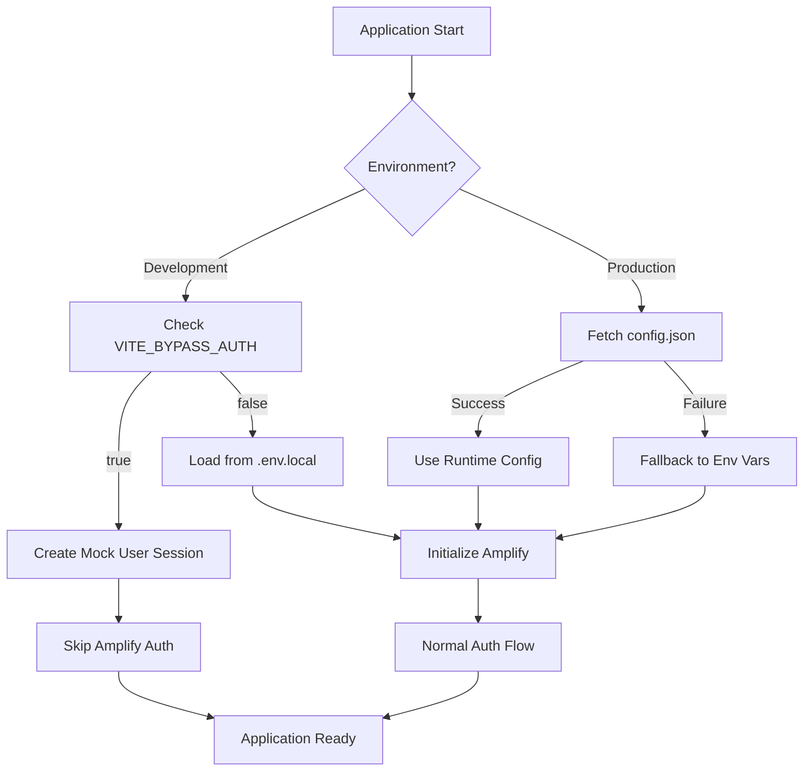

# Design Document: Configuration and Auth Bypass

## Overview

This design implements a dual configuration loading strategy for Nexus Telco UI that supports both local development (via `.env.local`) and production deployments (via `config.json`). It also adds an authentication bypass feature for local development.

The implementation leverages the existing `amplify.ts` configuration module and `EnterpriseAuthContext.tsx`, extending them with:
1. A unified configuration service that handles both config sources
2. Auth bypass logic in the authentication context
3. Environment detection for automatic source selection

## Architecture



## Components and Interfaces

### 1. Configuration Service (`src/services/configService.ts`)

A new service that provides a unified interface for configuration loading.

```typescript
interface AppConfig {
  api: {
    baseUrl: string;
    timeout: number;
  };
  cognito: {
    userPoolId: string;
    clientId: string;
    domain: string;
    region: string;
    redirectSignIn: string;
    redirectSignOut: string;
  };
  bypassAuth: boolean;
  environment: 'development' | 'staging' | 'production';
}

interface ConfigService {
  getConfig(): Promise<AppConfig>;
  isConfigured(): Promise<boolean>;
  clearCache(): void;
}
```

### 2. Enhanced Amplify Configuration (`src/config/amplify.ts`)

Extends the existing amplify.ts to integrate with the new config service.

### 3. Enhanced EnterpriseAuthContext (`src/context/EnterpriseAuthContext.tsx`)

Adds auth bypass logic that checks `VITE_BYPASS_AUTH` and creates a mock session when enabled.

## Data Models

### AppConfig

```typescript
interface AppConfig {
  api: {
    baseUrl: string;
    timeout: number;
  };
  cognito: {
    userPoolId: string;
    clientId: string;
    domain: string;
    region: string;
    redirectSignIn: string;
    redirectSignOut: string;
  };
  bypassAuth: boolean;
  environment: 'development' | 'staging' | 'production';
}
```

### Mock User Profile (for auth bypass)

```typescript
const mockUserProfile: EnterpriseProfile = {
  id: 'local-dev-user',
  email: 'dev@local.test',
  full_name: 'Local Dev User',
  avatar_url: null,
  role: 'Admin',
  department: 'Development',
  managerId: null,
  employeeId: 'LOCAL-DEV-001',
  permissions: ROLE_PERMISSIONS['Admin'],
  lastLogin: new Date().toISOString(),
  authMethod: 'COGNITO',
  teamIds: [],
  created_at: new Date().toISOString(),
  updated_at: new Date().toISOString(),
  adfsGroups: []
};
```

## Correctness Properties

*A property is a characteristic or behavior that should hold true across all valid executions of a system-essentially, a formal statement about what the system should do. Properties serve as the bridge between human-readable specifications and machine-verifiable correctness guarantees.*

### Property 1: Environment variable priority in development
*For any* configuration where both environment variables and config.json values exist, when running in development mode, the configuration service should return the environment variable values.
**Validates: Requirements 1.2**

### Property 2: Config.json values used in production
*For any* valid config.json content, when running in production mode and config.json is successfully fetched, the configuration service should return the config.json values.
**Validates: Requirements 2.2**

### Property 3: Required field validation
*For any* config.json content missing required fields (cognito.userPoolId, cognito.clientId, or api.baseUrl), the configuration service should reject the config and fall back to environment variables.
**Validates: Requirements 2.4**

### Property 4: Configuration priority order
*For any* configuration scenario, the configuration service should follow the priority: Runtime config.json (production) > Environment variables > Defaults.
**Validates: Requirements 5.1**

### Property 5: Error message clarity
*For any* configuration loading failure, the configuration service should provide an error message that identifies the specific failure reason.
**Validates: Requirements 5.2**

## Error Handling

### Configuration Loading Errors

| Error Scenario | Handling Strategy |
|----------------|-------------------|
| config.json fetch fails (network) | Log warning, fall back to env vars |
| config.json invalid JSON | Log error, fall back to env vars |
| config.json missing required fields | Log warning with field names, fall back to env vars |
| No configuration available | Throw error with clear message |

### Auth Bypass Errors

| Error Scenario | Handling Strategy |
|----------------|-------------------|
| Bypass enabled in production | Log severe warning (but allow for testing) |
| Mock session creation fails | Log error, disable bypass |

## Testing Strategy

### Property-Based Testing

The implementation will use **fast-check** as the property-based testing library for TypeScript/JavaScript.

Each property-based test will:
- Run a minimum of 100 iterations
- Be tagged with a comment referencing the correctness property
- Use the format: `**Feature: config-and-auth-bypass, Property {number}: {property_text}**`

### Unit Tests

Unit tests will cover:
- Configuration service initialization
- Environment detection logic
- Auth bypass mock user creation
- Config caching behavior

### Test File Structure

```
src/services/__tests__/
  configService.test.ts       # Unit tests for config service
  configService.property.ts   # Property-based tests for config service

src/context/__tests__/
  EnterpriseAuthContext.test.tsx  # Unit tests for auth bypass
```

### Property Test Examples

```typescript
// Property 1: Environment variable priority in development
// **Feature: config-and-auth-bypass, Property 1: Environment variable priority in development**
fc.assert(
  fc.property(
    fc.record({
      envApiUrl: fc.webUrl(),
      jsonApiUrl: fc.webUrl()
    }),
    ({ envApiUrl, jsonApiUrl }) => {
      // Setup: mock development environment with both sources
      // Assert: env var value is returned
    }
  ),
  { numRuns: 100 }
);
```
