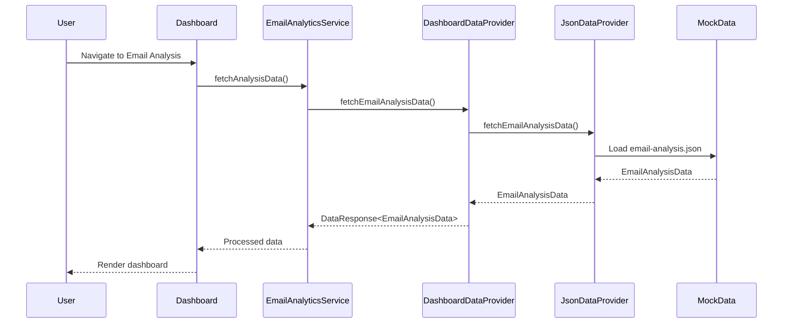

# Design Document: Email Analysis for Deal Potential and Revenue Impact

## Overview

This design document describes the technical architecture for extending the Nexus Telco UI call analytics platform to support email analysis. The feature extracts deal potential and revenue impact from email communications, mirroring existing call analysis capabilities while adapting to email-specific characteristics.

The implementation follows a UI-level only approach using mock/generated email data and analysis results, integrating seamlessly with the existing dashboard architecture, data providers, and component patterns.

### Key Design Principles

1. **Parallel Structure**: Email analysis mirrors call analysis in data models, services, and UI components
2. **Reuse**: Leverage existing UI components, patterns, and infrastructure where possible
3. **Consistency**: Follow established coding conventions and architectural patterns
4. **Extensibility**: Design for future backend integration while working with mock data initially

## Architecture

### High-Level Architecture

```mermaid
graph TB
    subgraph UI Layer
        ED[EmailAnalysisDashboard]
        ET[EmailsTable]
        EM[EmailDetailModal]
        EA[EmailAnalysisTab]
    end
    
    subgraph Service Layer
        EAS[EmailAnalyticsService]
        DDP[DashboardDataProvider]
    end
    
    subgraph Data Layer
        JDP[JsonDataProvider]
        ADP[ApiDataProvider]
    end
    
    subgraph Mock Data
        EMD[/public/emails/]
        EAR[/public/results/email-analysis.json]
    end
    
    ED --> EAS
    ET --> EAS
    EM --> EAS
    EA --> EAS
    
    EAS --> DDP
    DDP --> JDP
    DDP --> ADP
    
    JDP --> EMD
    JDP --> EAR
```

### Data Flow



## Components and Interfaces

### Component Hierarchy

```
src/
├── types/
│   └── email-analysis.ts          # TypeScript interfaces
├── services/
│   ├── emailAnalyticsService.ts   # Email analytics service
│   └── providers/
│       ├── jsonDataProvider.ts    # Extended for email data
│       └── apiDataProvider.ts     # Extended for email data
├── components/
│   ├── dashboards/
│   │   └── EmailAnalysisDashboard.tsx
│   └── processed-emails/
│       ├── EmailsTable.tsx
│       ├── EmailDetailModal.tsx
│       ├── EmailOverviewTab.tsx
│       ├── EmailContentTab.tsx
│       ├── EmailAnalysisTab.tsx
│       └── FilterBar.tsx
└── public/
    ├── emails/
    │   └── [mock email thread files]
    └── results/
        └── email-analysis.json
```

### Key Interfaces

#### EmailAnalyticsService

```typescript
interface IEmailAnalyticsService {
  fetchAnalysisData(
    agentFilter?: string,
    dateFrom?: string,
    dateTo?: string,
    dataSource?: DataSource
  ): Promise<EmailAnalysisData>;
  
  getSummaryStats(data: EmailAnalysisData): EmailSummaryStats;
  getTopPerformers(data: EmailAnalysisData, limit?: number): AgentPerformance[];
  getRecentAlerts(data: EmailAnalysisData): EmailAlert[];
  clearCache(): void;
}
```

#### Dashboard Data Provider Extension

```typescript
// Extension to existing DashboardDataProvider
interface IDashboardDataProvider {
  // Existing methods...
  fetchEmailAnalysisData(
    agentFilter?: string,
    dateFrom?: string,
    dateTo?: string,
    dataSource?: DataSource
  ): Promise<DataResponse<EmailAnalysisData>>;
}
```

### Component Specifications

#### EmailAnalysisDashboard

- Displays KPI cards: Total Emails, Pipeline Value, High Probability Deals, At Risk Deals
- Renders deal distribution charts using Recharts
- Integrates with RefreshContext for data refresh
- Supports filtering by agent and date range
- Props: `className?: string`

#### EmailsTable

- Displays email threads in tabular format
- Columns: Subject, Company, Agent, Date, Deal Value, Probability, Status
- Supports sorting and filtering
- Row click opens EmailDetailModal
- Props: `emails: EmailAnalysis[], onSelect: (email: EmailAnalysis) => void`

#### EmailDetailModal

- Modal dialog for detailed email thread view
- Tabs: Overview, Email Content, Analysis, Salesforce
- Displays deal potential, sentiment, and engagement metrics
- Props: `email: EmailAnalysis, open: boolean, onClose: () => void`

## Data Models

### Core Type Definitions

```typescript
// src/types/email-analysis.ts

export interface EmailMessage {
  message_id: string;
  from: string;
  to: string[];
  cc?: string[];
  subject: string;
  body: string;
  timestamp: string;
  attachments?: string[];
}

export interface EmailThread {
  thread_id: string;
  subject_line: string;
  participants: string[];
  messages: EmailMessage[];
  email_count: number;
  thread_start: string;
  thread_end: string;
  thread_duration_hours: number;
}

export interface EmailEngagementMetrics {
  average_response_time_hours: number;
  response_rate: number;
  thread_activity_score: number;
  customer_initiated_count: number;
  agent_initiated_count: number;
}

export interface EmailSentimentAnalysis {
  overall_sentiment: number;
  customer_satisfaction: number;
  sentiment_progression: number[];
  key_sentiment_moments: SentimentMoment[];
}

export interface EmailDealPotential {
  estimated_value: number;
  probability: number;
  risk_factors: string[];
  next_steps: string[];
}

export interface EmailAnalysis {
  email_thread_id: string;
  thread: EmailThread;
  agent_name: string;
  customer_company: string;
  analysis_date: string;
  engagement_metrics: EmailEngagementMetrics;
  sentiment_analysis: EmailSentimentAnalysis;
  deal_potential: EmailDealPotential;
  recommendations: string[];
  products?: ProductInterest[];
}

export interface EmailAnalysisSummary {
  total_emails_analyzed: number;
  analysis_date: string;
  analysis_version: string;
  overall_engagement_score: number;
  average_response_time: string;
}

export interface EmailRevenueImpact {
  total_pipeline_value: number;
  high_probability_deals: number;
  at_risk_deals: number;
  coaching_roi_potential: number;
  monthly_revenue_projection: number;
}

export interface EmailAlertFlag {
  type: string;
  priority: string;
  agent: string;
  email_thread_id: string | null;
  issue: string;
  suggested_action: string;
}

export interface EmailAnalysisData {
  analysis_summary: EmailAnalysisSummary;
  individual_email_analysis: EmailAnalysis[];
  team_performance_summary: TeamPerformanceSummary;
  actionable_insights: ActionableInsights;
  revenue_impact: EmailRevenueImpact;
  alerts_and_flags: EmailAlertFlag[];
}

// Reused from qa-analysis.ts
export interface SentimentMoment {
  timestamp: string;
  sentiment: number;
  context: string;
}

export interface ProductInterest {
  product_name: string;
  product_type: string;
  estimated_monthly_cost: number;
  customer_interest: 'high' | 'low';
}

export interface TeamPerformanceSummary {
  top_performers: TopPerformer[];
  areas_for_improvement: ImprovementArea[];
}

export interface TopPerformer {
  agent_name: string;
  overall_score: number;
  strengths: string[];
}

export interface ImprovementArea {
  area: string;
  average_score: number;
  affected_agents: string[];
  training_priority: string;
}

export interface ActionableInsights {
  immediate_actions: string[];
  process_improvements: string[];
  coaching_opportunities: CoachingOpportunity[];
}

export interface CoachingOpportunity {
  agent: string;
  focus_areas: string[];
  coaching_score: number;
}
```

### Mock Data Structure

```json
// public/results/email-analysis.json
{
  "analysis_summary": {
    "total_emails_analyzed": 15,
    "analysis_date": "2025-08-15T00:00:00Z",
    "analysis_version": "1.0.0",
    "overall_engagement_score": 72.5,
    "average_response_time": "4.2 hours"
  },
  "individual_email_analysis": [
    {
      "email_thread_id": "ETH-001",
      "thread": {
        "thread_id": "ETH-001",
        "subject_line": "Re: Enterprise Solution Proposal",
        "participants": ["sales@company.com", "buyer@customer.com"],
        "email_count": 8,
        "thread_start": "2025-08-01T09:00:00Z",
        "thread_end": "2025-08-10T14:30:00Z",
        "thread_duration_hours": 221.5
      },
      "agent_name": "Louise",
      "customer_company": "TechCorp Industries",
      "deal_potential": {
        "estimated_value": 45000,
        "probability": 0.75,
        "risk_factors": ["Budget approval pending", "Competitor evaluation"],
        "next_steps": ["Schedule demo", "Send ROI analysis"]
      }
    }
  ],
  "revenue_impact": {
    "total_pipeline_value": 285000,
    "high_probability_deals": 5,
    "at_risk_deals": 2,
    "coaching_roi_potential": 42000,
    "monthly_revenue_projection": 95000
  }
}
```


## Correctness Properties

*A property is a characteristic or behavior that should hold true across all valid executions of a system—essentially, a formal statement about what the system should do. Properties serve as the bridge between human-readable specifications and machine-verifiable correctness guarantees.*

Based on the acceptance criteria analysis, the following correctness properties have been identified for property-based testing:

### Property 1: Email-Specific Fields Presence

*For any* valid EmailAnalysis object, it SHALL contain all required email-specific fields: email_thread_id, subject_line (via thread), participants (via thread), email_count (via thread), thread_duration_hours (via thread), and response times (via engagement_metrics).

**Validates: Requirements 1.2**

### Property 2: Singleton Pattern Consistency

*For any* number of calls to EmailAnalyticsService.getInstance(), the returned instance SHALL always be the same object reference.

**Validates: Requirements 2.1**

### Property 3: Filtering Correctness

*For any* valid filter combination (agent, date range, data source) applied to EmailAnalysisData, all returned email analyses SHALL match the specified filter criteria, and no matching items SHALL be excluded.

**Validates: Requirements 2.3, 6.4, 9.5**

### Property 4: Summary Statistics Calculation

*For any* valid EmailAnalysisData with N email analyses, the calculated summary statistics SHALL satisfy:
- total_emails_analyzed equals N
- overall_engagement_score equals the average of all individual engagement scores
- average_response_time equals the mean of all individual response times

**Validates: Requirements 2.4**

### Property 5: Engagement Metrics Calculation

*For any* email thread with a sequence of response times, the calculated engagement metrics SHALL satisfy:
- average_response_time equals the arithmetic mean of all response times
- response_rate equals (responses received / messages sent) as a percentage
- thread_activity_score is bounded between 0 and 100

**Validates: Requirements 2.5, 5.4**

### Property 6: Deal Status Classification

*For any* email analysis with given probability, estimated_value, and risk_factors:
- probability >= 0.8 OR (estimated_value > 10000 AND probability >= 0.6) → "Hot Lead"
- probability >= 0.6 OR (estimated_value > 5000 AND probability >= 0.4) → "Warm Lead"
- risk_factors.length > 2 OR overall_score < 70 → "High Risk"
- has next_steps AND lower probability → "Follow-up Required"
- estimated_value > 50000 → "High Value"
- otherwise → "Standard"

**Validates: Requirements 3.2**

### Property 7: Pipeline Value Aggregation

*For any* collection of email analyses, the total_pipeline_value SHALL equal the sum of all individual deal_potential.estimated_value fields.

**Validates: Requirements 3.5**

### Property 8: Revenue Projection Calculation

*For any* collection of email analyses with deal potentials, the monthly_revenue_projection SHALL equal the sum of (estimated_value × probability) for all deals, divided by the projection period factor.

**Validates: Requirements 4.2**

### Property 9: Sentiment Progression Consistency

*For any* email thread with N messages, the sentiment_progression array SHALL have exactly N elements, each representing the sentiment score at that point in the conversation.

**Validates: Requirements 5.2**

### Property 10: Low Engagement Flagging

*For any* email thread where engagement_metrics.thread_activity_score falls below the defined threshold, the thread SHALL appear in the alerts_and_flags array with appropriate priority.

**Validates: Requirements 5.5**

### Property 11: Sorting Correctness

*For any* sort operation on email analyses by a given field (deal_value, probability, date, engagement_score) and direction (asc/desc), the resulting array SHALL be correctly ordered such that for all adjacent pairs (a, b), the comparison a[field] <= b[field] (for asc) or a[field] >= b[field] (for desc) holds.

**Validates: Requirements 6.5**

### Property 12: Risk Factor Aggregation

*For any* collection of email analyses, the aggregated team-level risk factors SHALL contain all unique risk factors from individual analyses, with no duplicates and no omissions.

**Validates: Requirements 8.4**

### Property 13: Agent Performance Calculation

*For any* agent with N email analyses, the calculated performance score SHALL be derived from:
- Average engagement score across all threads
- Deal conversion rate (high probability deals / total deals)
- Response time performance relative to team average

**Validates: Requirements 9.1**

### Property 14: Serialization Round-Trip

*For any* valid EmailAnalysisData object, serializing to JSON and then deserializing back SHALL produce an object that is deeply equal to the original.

**Validates: Requirements 10.1, 10.2, 10.3**

## Error Handling

### Data Loading Errors

| Error Scenario | Handling Strategy |
|----------------|-------------------|
| JSON file not found | Fall back to empty data with warning message |
| Malformed JSON | Display error alert, offer retry option |
| Network timeout (API) | Fall back to JSON provider |
| Invalid data structure | Apply default values, log warning |

### UI Error States

```typescript
interface ErrorState {
  hasError: boolean;
  errorMessage: string;
  canRetry: boolean;
  fallbackAvailable: boolean;
}
```

Components should display appropriate error states:
- Loading spinner during data fetch
- Error alert with retry button on failure
- Empty state message when no data available
- Graceful degradation when partial data available

### Validation Errors

- Missing required fields: Apply sensible defaults
- Invalid date formats: Parse with fallback to current date
- Negative numeric values: Clamp to zero
- Empty arrays: Initialize as empty, not null

## Testing Strategy

### Dual Testing Approach

This feature requires both unit tests and property-based tests for comprehensive coverage:

**Unit Tests**: Verify specific examples, edge cases, and error conditions
- Component rendering tests
- Service method behavior with specific inputs
- Error handling scenarios
- Integration with existing components

**Property-Based Tests**: Verify universal properties across all inputs
- Data transformation correctness
- Calculation accuracy
- Filtering and sorting behavior
- Serialization round-trips

### Property-Based Testing Configuration

- **Library**: fast-check (TypeScript property-based testing library)
- **Minimum iterations**: 100 per property test
- **Tag format**: `Feature: email-analysis, Property {number}: {property_text}`

### Test File Structure

```
src/
├── types/__tests__/
│   └── email-analysis.test.ts       # Type validation tests
├── services/__tests__/
│   └── emailAnalyticsService.test.ts # Service unit + property tests
└── components/__tests__/
    └── EmailAnalysisDashboard.test.tsx # Component tests
```

### Property Test Examples

```typescript
// Example: Property 14 - Serialization Round-Trip
import * as fc from 'fast-check';

describe('EmailAnalysisData Serialization', () => {
  it('Feature: email-analysis, Property 14: Serialization round-trip', () => {
    fc.assert(
      fc.property(
        emailAnalysisDataArbitrary,
        (data: EmailAnalysisData) => {
          const serialized = JSON.stringify(data);
          const deserialized = JSON.parse(serialized) as EmailAnalysisData;
          return deepEqual(data, deserialized);
        }
      ),
      { numRuns: 100 }
    );
  });
});

// Example: Property 7 - Pipeline Value Aggregation
describe('Pipeline Aggregation', () => {
  it('Feature: email-analysis, Property 7: Pipeline value aggregation', () => {
    fc.assert(
      fc.property(
        fc.array(emailAnalysisArbitrary, { minLength: 1, maxLength: 50 }),
        (analyses: EmailAnalysis[]) => {
          const expectedTotal = analyses.reduce(
            (sum, a) => sum + a.deal_potential.estimated_value,
            0
          );
          const calculatedTotal = calculatePipelineValue(analyses);
          return calculatedTotal === expectedTotal;
        }
      ),
      { numRuns: 100 }
    );
  });
});
```

### Test Data Generators (Arbitraries)

```typescript
// Arbitrary generators for property-based testing
const emailMessageArbitrary = fc.record({
  message_id: fc.uuid(),
  from: fc.emailAddress(),
  to: fc.array(fc.emailAddress(), { minLength: 1, maxLength: 5 }),
  subject: fc.string({ minLength: 1, maxLength: 200 }),
  body: fc.string({ minLength: 1, maxLength: 5000 }),
  timestamp: fc.date().map(d => d.toISOString())
});

const dealPotentialArbitrary = fc.record({
  estimated_value: fc.integer({ min: 0, max: 1000000 }),
  probability: fc.float({ min: 0, max: 1 }),
  risk_factors: fc.array(fc.string(), { maxLength: 5 }),
  next_steps: fc.array(fc.string(), { maxLength: 5 })
});

const emailAnalysisArbitrary = fc.record({
  email_thread_id: fc.uuid(),
  agent_name: fc.string({ minLength: 1, maxLength: 50 }),
  customer_company: fc.string({ minLength: 1, maxLength: 100 }),
  deal_potential: dealPotentialArbitrary,
  // ... other fields
});
```

### Coverage Requirements

- All 14 correctness properties must have corresponding property-based tests
- Unit tests for edge cases identified in prework (10.4: malformed data handling)
- Component tests for UI rendering and interaction
- Integration tests for data provider fallback behavior
