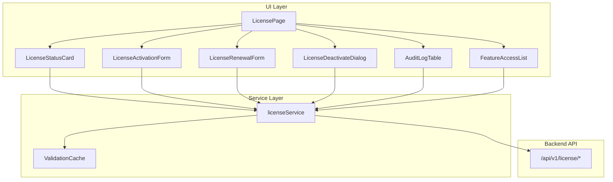

# Design Document: License Management UI

## Overview

The License Management feature provides a comprehensive UI for managing software licenses within the nexus-ui application. It integrates with the nexus-backend License API to enable users to view license status, activate/deactivate licenses, renew licenses, view audit logs, and check feature access based on license tier.

The feature is implemented as a new "License" tab within the existing Settings page, following the established patterns and component library used throughout the application.

## Architecture



## Components and Interfaces

### 1. LicensePage Component

The main container component that orchestrates all license management functionality.

```typescript
interface LicensePageProps {
  // No props - uses internal state and service
}

interface LicensePageState {
  status: LicenseStatusData | null;
  isLoading: boolean;
  error: string | null;
  activeSection: 'status' | 'audit' | 'features';
}
```

### 2. LicenseStatusCard Component

Displays the current license status with visual indicators.

```typescript
interface LicenseStatusCardProps {
  status: LicenseStatusData | null;
  isLoading: boolean;
  error: string | null;
  onRefresh: () => void;
}

// Status indicator colors
const STATUS_COLORS = {
  active: 'green',
  expired: 'red',
  grace_period: 'yellow',
  not_activated: 'gray',
  revoked: 'red',
  deactivated: 'gray',
};
```

### 3. LicenseActivationForm Component

Form for entering and activating license keys.

```typescript
interface LicenseActivationFormProps {
  onActivate: (key: string, instanceId?: string) => Promise<void>;
  isActivating: boolean;
  error: ActivationError | null;
  isLicenseActive: boolean;
}

interface ActivationFormData {
  licenseKey: string;
  instanceId?: string;
}
```

### 4. LicenseRenewalForm Component

Form for renewing licenses with renewal keys.

```typescript
interface LicenseRenewalFormProps {
  onRenew: (renewalKey: string) => Promise<void>;
  isRenewing: boolean;
  error: RenewalError | null;
  currentExpiration: Date | null;
}
```

### 5. LicenseDeactivateDialog Component

Confirmation dialog for license deactivation.

```typescript
interface LicenseDeactivateDialogProps {
  isOpen: boolean;
  onClose: () => void;
  onConfirm: (reason: string) => Promise<void>;
  isDeactivating: boolean;
  licenseId: string | null;
}
```

### 6. AuditLogTable Component

Paginated table displaying license audit history.

```typescript
interface AuditLogTableProps {
  logs: AuditLogEntry[];
  isLoading: boolean;
  totalCount: number;
  pageSize: number;
  currentPage: number;
  onPageChange: (page: number) => void;
  onDateRangeChange: (start: Date | null, end: Date | null) => void;
}

interface AuditLogEntry {
  event_id: string;
  timestamp: Date;
  event_type: LicenseEventType;
  license_id: string | null;
  details: Record<string, unknown>;
  result: 'success' | 'failure';
  ip_address: string | null;
}
```

### 7. FeatureAccessList Component

Displays features and their tier requirements.

```typescript
interface FeatureAccessListProps {
  currentTier: LicenseTier | null;
  features: FeatureAccessItem[];
  isLoading: boolean;
}

interface FeatureAccessItem {
  feature_id: string;
  feature_name: string;
  description: string;
  required_tier: LicenseTier;
  is_allowed: boolean;
}
```

### 8. License Service

Service layer for API communication.

```typescript
interface LicenseService {
  // Status operations
  getStatus(): Promise<LicenseStatusResponse>;
  validateLicense(): Promise<LicenseValidationResult>;
  
  // Activation operations
  activateLicense(request: LicenseActivationRequest): Promise<LicenseActivationResponse>;
  deactivateLicense(request: LicenseDeactivationRequest): Promise<LicenseDeactivationResponse>;
  renewLicense(request: LicenseRenewalRequest): Promise<LicenseRenewalResponse>;
  
  // Audit operations
  getAuditLogs(params: AuditLogsParams): Promise<AuditLogsResponse>;
  
  // Feature operations
  checkFeatureAccess(featureId: string): Promise<FeatureAccessResponse>;
  
  // Cache management
  clearCache(): void;
}
```

## Data Models

### License Status Data

```typescript
interface LicenseStatusData {
  license_status: LicenseStatus;
  license_id: string | null;
  tier: LicenseTier | null;
  holder_name: string | null;
  activated_at: string | null;
  expires_at: string | null;
  days_remaining: number | null;
  is_expiring_soon: boolean;
  expiration_warning: string | null;
  features: string[];
  grace_period: GracePeriodInfo | null;
  usage_stats: Record<string, number> | null;
  message: string | null;
  activation_instructions: string | null;
}

type LicenseStatus = 
  | 'active' 
  | 'expired' 
  | 'grace_period' 
  | 'revoked' 
  | 'deactivated' 
  | 'not_activated';

type LicenseTier = 'basic' | 'professional' | 'enterprise';

interface GracePeriodInfo {
  is_in_grace_period: boolean;
  grace_period_ends_at: string | null;
  days_remaining: number | null;
  restrictions: string[];
}
```

### API Request/Response Types

```typescript
interface LicenseActivationRequest {
  license_key: string;
  instance_id?: string;
  metadata?: Record<string, unknown>;
}

interface LicenseActivationResponse {
  status: 'success' | 'error';
  message: string;
  data?: LicenseActivationData;
  error_code?: string;
  details?: Record<string, unknown>;
}

interface LicenseDeactivationRequest {
  reason: string;
  confirm: boolean;
}

interface LicenseRenewalRequest {
  renewal_key: string;
}

interface AuditLogsParams {
  start_date?: string;
  end_date?: string;
  limit?: number;
  offset?: number;
}
```


## Correctness Properties

*A property is a characteristic or behavior that should hold true across all valid executions of a system—essentially, a formal statement about what the system should do. Properties serve as the bridge between human-readable specifications and machine-verifiable correctness guarantees.*

### Property 1: Status Indicator Mapping

*For any* license status value, the LicenseStatusCard SHALL render the correct color indicator and label according to the status-to-indicator mapping:
- 'active' → green indicator, "Active" label
- 'expired' → red indicator, "Expired" label  
- 'grace_period' → yellow indicator, "Grace Period" label
- 'not_activated' → gray indicator, "Not Activated" label
- 'revoked' → red indicator, "Revoked" label
- 'deactivated' → gray indicator, "Deactivated" label

**Validates: Requirements 1.2, 1.3, 1.4, 1.5**

### Property 2: License Key Validation

*For any* string that does not match the license key format pattern (version.tier.date.holder.features.signature), the LicenseActivationForm SHALL display a validation error and SHALL NOT call the backend API.

**Validates: Requirements 2.2**

### Property 3: Error Display Consistency

*For any* API error response containing a message and error_code, the License_Page SHALL display both the error message and error code to the user.

**Validates: Requirements 2.3, 3.4, 4.3, 7.2, 8.2**

### Property 4: Loading State UI

*For any* async operation in progress (isActivating, isRenewing, isDeactivating), the corresponding form SHALL disable its submit button and display a loading indicator.

**Validates: Requirements 2.6, 4.5**

### Property 5: Disabled When Not Activated

*For any* license status of 'not_activated', the deactivate button SHALL be disabled AND the renewal form SHALL be hidden.

**Validates: Requirements 3.5, 4.4**

### Property 6: Feature Access Display

*For any* feature in the Feature_Access_List:
- If currentTier >= requiredTier, the feature SHALL be displayed as accessible (green/enabled styling)
- If currentTier < requiredTier OR currentTier is null, the feature SHALL be displayed as inaccessible (gray/disabled styling) with an upgrade message

**Validates: Requirements 6.2, 6.3, 6.4**

### Property 7: Audit Log Entry Rendering

*For any* audit log entry, the Audit_Log_Table SHALL render the timestamp, event_type with appropriate icon, and result status.

**Validates: Requirements 5.1, 5.5**

### Property 8: Days Remaining Display

*For any* active license status with days_remaining value, the LicenseStatusCard SHALL display the days remaining. When days_remaining <= 30, an expiration warning SHALL be displayed.

**Validates: Requirements 1.6, 1.7**

### Property 9: Validation Cache Behavior

*For any* sequence of getStatus() calls within the cache TTL period, only the first call SHALL result in an API request; subsequent calls SHALL return cached data.

**Validates: Requirements 7.3**

### Property 10: Network Error Handling

*For any* network error (fetch failure, timeout), the License_Page SHALL display a connection error message with a retry button.

**Validates: Requirements 8.1, 8.3**

## Error Handling

### Error Types

```typescript
type LicenseErrorType = 
  | 'network'      // Network connectivity issues
  | 'auth'         // Authentication/authorization failures
  | 'validation'   // Client-side validation errors
  | 'api'          // Backend API errors
  | 'timeout'      // Request timeout
  | 'unknown';     // Unexpected errors

interface LicenseError {
  type: LicenseErrorType;
  message: string;
  code?: string;
  details?: Record<string, unknown>;
  retryable: boolean;
}
```

### Error Code Mapping

| Error Code | Description | User Action |
|------------|-------------|-------------|
| INVALID_FORMAT | License key format is invalid | Check key format |
| SIGNATURE_INVALID | License signature verification failed | Contact support |
| LICENSE_EXPIRED | License has expired | Renew license |
| NOT_ACTIVATED | No license is currently activated | Activate a license |
| ALREADY_ACTIVATED | License is already activated elsewhere | Deactivate first |
| RENEWAL_INVALID | Renewal key doesn't match current license | Check renewal key |
| CONFIRMATION_REQUIRED | Deactivation requires confirmation | Confirm action |

### Error Recovery Strategies

1. **Network Errors**: Show retry button, implement exponential backoff
2. **Auth Errors**: Redirect to login or show re-authentication prompt
3. **Validation Errors**: Highlight invalid fields, show inline errors
4. **API Errors**: Display error message with help link
5. **Timeout Errors**: Show timeout message with retry option

## Testing Strategy

### Unit Tests

Unit tests focus on individual component behavior and utility functions:

1. **LicenseStatusCard Tests**
   - Renders correct status indicator for each status value
   - Displays days remaining when provided
   - Shows expiration warning when is_expiring_soon is true
   - Handles null/undefined status gracefully

2. **LicenseActivationForm Tests**
   - Validates license key format before submission
   - Disables submit button during activation
   - Displays error messages from failed activation
   - Clears form after successful activation

3. **AuditLogTable Tests**
   - Renders log entries with correct fields
   - Handles pagination correctly
   - Filters by date range
   - Expands entries to show details

4. **FeatureAccessList Tests**
   - Displays features with tier requirements
   - Shows accessible/inaccessible styling based on tier
   - Displays upgrade message for higher-tier features

5. **License Service Tests**
   - Makes correct API calls with proper parameters
   - Handles API errors appropriately
   - Caches validation results
   - Clears cache when requested

### Property-Based Tests

Property-based tests verify universal properties across many generated inputs using a PBT library (e.g., fast-check for TypeScript):

1. **Property 1 Test**: Status Indicator Mapping
   - Generate random LicenseStatus values
   - Verify correct indicator color and label for each

2. **Property 2 Test**: License Key Validation
   - Generate random invalid strings
   - Verify validation error is shown and no API call is made

3. **Property 3 Test**: Error Display Consistency
   - Generate random error responses with message and code
   - Verify both are displayed in the UI

4. **Property 6 Test**: Feature Access Display
   - Generate random tier combinations (current vs required)
   - Verify correct accessible/inaccessible styling

5. **Property 9 Test**: Validation Cache Behavior
   - Make multiple getStatus() calls
   - Verify only first call hits API within cache TTL

### Integration Tests

Integration tests verify component interactions and API integration:

1. **Activation Flow**: Enter key → Submit → Verify API call → Verify status update
2. **Deactivation Flow**: Click deactivate → Confirm → Verify API call → Verify status update
3. **Renewal Flow**: Enter renewal key → Submit → Verify API call → Verify new expiration
4. **Audit Log Loading**: Navigate to audit tab → Verify logs loaded → Test pagination

### Test Configuration

- Property-based tests: Minimum 100 iterations per property
- Use fast-check library for TypeScript property-based testing
- Mock API calls in unit tests using MSW (Mock Service Worker)
- Use React Testing Library for component tests
