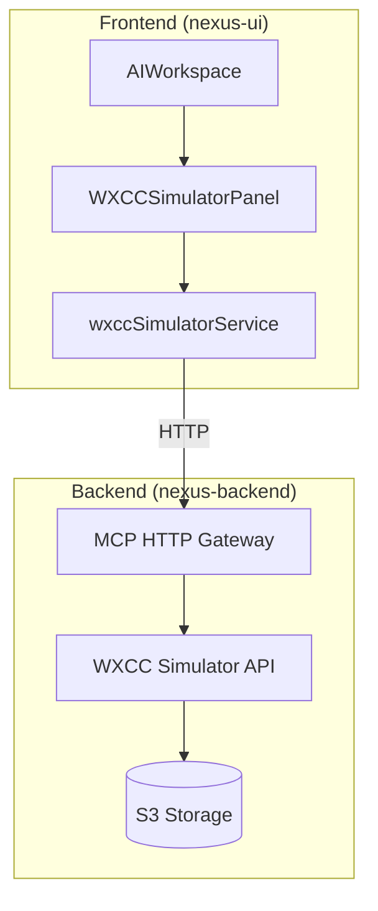

# Design Document: WXCC Simulator UI

## Overview

This design document describes the implementation of a WXCC Simulator management interface as a new tab within the existing AI Workspace component in nexus-ui. The UI will provide a comprehensive interface for managing the WXCC Simulator backend, allowing developers to view status, browse tasks, seed test data, and play recordings without leaving the application.

The implementation follows the existing patterns established by the BackendDebugPlatform component and leverages the existing backendDebugService for API communication.

## Architecture



### Component Hierarchy

```
AIWorkspace
├── TabsList
│   ├── Agent Instructions Tab
│   ├── Chatbot Editor Tab
│   ├── Backend Debug Tab
│   └── WXCC Simulator Tab (NEW)
└── TabsContent
    ├── AgentInstructionsEditor
    ├── ChatbotEditor
    ├── BackendDebugPlatform
    └── WXCCSimulatorPanel (NEW)
        ├── SimulatorStatusCard
        ├── SimulatorStatistics
        ├── SimulatorToolbar
        │   ├── FilterControls
        │   ├── SearchInput
        │   └── ActionButtons (Seed, Reset, Refresh)
        ├── TasksTable
        │   └── TaskRow (clickable)
        ├── TaskDetailsModal
        │   └── RecordingPlayer
        ├── SeedDataDialog
        └── ResetConfirmDialog
```

## Components and Interfaces

### 1. WXCCSimulatorPanel (Main Container)

The main container component that orchestrates all simulator UI functionality.

```typescript
interface WXCCSimulatorPanelProps {
  // No props needed - self-contained component
}

interface WXCCSimulatorPanelState {
  status: SimulatorStatus | null;
  tasks: Task[];
  filteredTasks: Task[];
  selectedTask: Task | null;
  isLoading: boolean;
  error: string | null;
  filters: TaskFilters;
  searchQuery: string;
  showSeedDialog: boolean;
  showResetDialog: boolean;
  showTaskDetails: boolean;
}
```

### 2. SimulatorStatusCard

Displays the current simulator status information.

```typescript
interface SimulatorStatusCardProps {
  status: SimulatorStatus | null;
  isLoading: boolean;
  error: string | null;
  onRefresh: () => void;
}
```

### 3. SimulatorStatistics

Displays summary statistics about the simulator data.

```typescript
interface SimulatorStatisticsProps {
  tasks: Task[];
}

interface TaskStatistics {
  total: number;
  byStatus: Record<TaskStatus, number>;
  byDirection: Record<TaskDirection, number>;
  withRecordings: number;
}
```

### 4. TasksTable

Paginated table displaying tasks with sorting and selection.

```typescript
interface TasksTableProps {
  tasks: Task[];
  isLoading: boolean;
  onTaskSelect: (task: Task) => void;
  selectedTaskId: string | null;
}
```

### 5. TaskDetailsModal

Modal displaying full task details and recordings.

```typescript
interface TaskDetailsModalProps {
  task: Task | null;
  recordings: Recording[];
  isOpen: boolean;
  onClose: () => void;
}
```

### 6. RecordingPlayer

Audio player component for recording playback.

```typescript
interface RecordingPlayerProps {
  recording: Recording;
  audioUrl: string;
}
```

### 7. SeedDataDialog

Configuration dialog for seeding test data.

```typescript
interface SeedDataDialogProps {
  isOpen: boolean;
  onClose: () => void;
  onConfirm: (config: SeedConfig) => void;
  isSeeding: boolean;
}

interface SeedConfig {
  numTasks: number;
  daysBack: number;
  includeRecordings: boolean;
  resetFirst: boolean;
}
```

### 8. FilterControls

Filter controls for task list filtering.

```typescript
interface FilterControlsProps {
  filters: TaskFilters;
  onFiltersChange: (filters: TaskFilters) => void;
}

interface TaskFilters {
  status: TaskStatus | 'all';
  direction: TaskDirection | 'all';
}
```

## Data Models

### TypeScript Interfaces (matching backend models)

```typescript
// Enums
type TaskStatus = 'active' | 'completed' | 'abandoned' | 'transferred';
type TaskDirection = 'inbound' | 'outbound';
type ChannelType = 'telephony' | 'chat' | 'email' | 'social';
type CallType = 'inbound' | 'outbound' | 'callback';

// Task Models
interface TaskAttributes {
  status: TaskStatus;
  direction: TaskDirection;
  origin: string;
  destination: string;
  queueId?: string;
  queueName?: string;
  agentId?: string;
  agentName?: string;
  wrapUpCode?: string;
  ani?: string;
  dnis?: string;
}

interface Task {
  id: string;
  taskName: string;
  channelType: ChannelType;
  startTime: string;
  endTime?: string;
  createdTime?: number;
  lastUpdatedTime?: number;
  attributes: TaskAttributes;
}

// Recording Models
interface RecordingAttributes {
  fileName: string;
  filePath: string;
  startTime: number;
  stopTime: number;
  participants: string[];
  channel1?: string;
  channel2?: string;
  callType: CallType;
}

interface Recording {
  id: string;
  attributes: RecordingAttributes;
}

interface TaskRecording {
  taskId: string;
  recording: Recording[];
}

// API Response Models
interface TasksResponse {
  data: Task[];
  meta?: { totalCount?: number };
}

interface CapturesResponse {
  data: TaskRecording[];
  meta?: Record<string, unknown>;
}

interface SimulatorStatus {
  enabled: boolean;
  org_id: string;
  bucket: string;
  prefix: string;
  task_count: number;
  recording_count: number;
  last_updated?: string;
}

interface AdminResponse {
  success: boolean;
  message: string;
  data?: Record<string, unknown>;
  timestamp: string;
}

// Request Models
interface SeedDataRequest {
  num_tasks: number;
  include_recordings: boolean;
  days_back: number;
  use_current_time?: boolean;
  org_id?: string;
}
```

## Service Layer

### wxccSimulatorService

A new service module following the pattern of backendDebugService.

```typescript
// src/services/wxccSimulatorService.ts

class WXCCSimulatorService {
  private baseUrl: string;
  private simToken: string;
  
  // Status & Health
  async getStatus(): Promise<SimulatorStatus>;
  async healthCheck(): Promise<HealthResponse>;
  
  // Tasks (WXCC-compatible endpoints)
  async getTasks(params: GetTasksParams): Promise<TasksResponse>;
  async getCaptures(taskIds: string[]): Promise<CapturesResponse>;
  
  // Admin Operations
  async seedData(config: SeedDataRequest): Promise<AdminResponse>;
  async resetData(): Promise<AdminResponse>;
  async createTask(request: CreateTaskRequest): Promise<AdminResponse>;
  async deleteTask(taskId: string): Promise<AdminResponse>;
  
  // Recordings
  getRecordingUrl(recordingId: string): string;
  async getRecordingPresignedUrl(recordingId: string): Promise<string>;
}
```

### API Endpoints Used

| Endpoint | Method | Description |
|----------|--------|-------------|
| `/v1/sim/admin/status` | GET | Get simulator status |
| `/v1/sim/health` | GET | Health check |
| `/v1/tasks` | GET | List tasks (requires auth) |
| `/v1/captures/query` | POST | Get recordings for tasks |
| `/v1/sim/admin/seed` | POST | Seed sample data |
| `/v1/sim/admin/reset` | POST | Reset all data |
| `/v1/sim/recordings/{id}` | GET | Stream recording |

## Correctness Properties

*A property is a characteristic or behavior that should hold true across all valid executions of a system-essentially, a formal statement about what the system should do. Properties serve as the bridge between human-readable specifications and machine-verifiable correctness guarantees.*

### Property 1: Status Display Completeness

*For any* valid SimulatorStatus object returned by the API, the SimulatorStatusCard component SHALL render all required fields: enabled state, organization ID, S3 bucket, task count, and recording count.

**Validates: Requirements 2.1**

### Property 2: Task Table Column Completeness

*For any* Task object, the TasksTable component SHALL display all required columns: Task ID (truncated), Status (with icon), Direction, Origin, Destination, Queue, Agent, and Recording indicator.

**Validates: Requirements 3.1**

### Property 3: Task Sorting Order

*For any* list of tasks displayed in the TasksTable, the tasks SHALL be sorted by createdTime in descending order (newest first).

**Validates: Requirements 3.2**

### Property 4: Status Visual Indicators

*For any* task status value (completed, abandoned, transferred), the TasksTable SHALL display a corresponding visual indicator (icon and/or color) that uniquely identifies that status.

**Validates: Requirements 3.4**

### Property 5: Recording Indicator Accuracy

*For any* task, the recording indicator icon SHALL be displayed if and only if the task has one or more associated recordings.

**Validates: Requirements 3.5**

### Property 6: Filter Correctness

*For any* combination of status filter, direction filter, and search query applied to a task list, the filtered results SHALL contain only tasks that match ALL applied filter criteria.

**Validates: Requirements 4.4**

### Property 7: Filter Count Accuracy

*For any* filtered task list, the displayed count SHALL accurately show the number of filtered results and the total number of tasks.

**Validates: Requirements 4.5**

### Property 8: Task Details Completeness

*For any* Task object displayed in the TaskDetailsModal, all task attributes SHALL be visible: full task ID, startTime, endTime, status, direction, origin, destination, queueId, queueName, agentId, and agentName.

**Validates: Requirements 7.2**

### Property 9: Recording List in Details

*For any* task with associated recordings, the TaskDetailsModal SHALL display all recordings with playback controls.

**Validates: Requirements 7.3**

### Property 10: Statistics Accuracy

*For any* list of tasks, the SimulatorStatistics component SHALL display accurate counts for: total tasks, tasks grouped by status, and tasks grouped by direction.

**Validates: Requirements 9.1**

### Property 11: Error Resilience

*For any* API error response, the WXCCSimulatorPanel SHALL remain functional (not crash) and display an appropriate error message without losing existing state.

**Validates: Requirements 10.3**

## Error Handling

### Error States

1. **Connection Error**: Backend unreachable
   - Display: "Unable to connect to simulator backend"
   - Action: Retry button

2. **Authentication Error**: Invalid or missing token
   - Display: "Authentication failed - check simulator token configuration"
   - Action: Link to configuration

3. **Not Configured**: Simulator not enabled or S3 not configured
   - Display: "Simulator not configured"
   - Action: Configuration guidance

4. **API Error**: Server-side error
   - Display: Error message from API
   - Action: Retry button

5. **Recording Load Error**: Failed to load audio
   - Display: "Failed to load recording"
   - Action: Retry or download link

### Error Handling Strategy

```typescript
interface ErrorState {
  type: 'connection' | 'auth' | 'config' | 'api' | 'recording';
  message: string;
  details?: string;
  retryable: boolean;
}

function handleApiError(error: unknown): ErrorState {
  if (error instanceof TypeError && error.message.includes('fetch')) {
    return { type: 'connection', message: 'Unable to connect', retryable: true };
  }
  if (error.status === 401) {
    return { type: 'auth', message: 'Authentication failed', retryable: false };
  }
  if (error.status === 503) {
    return { type: 'config', message: 'Simulator not enabled', retryable: false };
  }
  return { type: 'api', message: error.message, retryable: true };
}
```

## Testing Strategy

### Unit Tests

Unit tests will verify specific examples and edge cases:

1. **Component Rendering**
   - SimulatorStatusCard renders with valid status
   - SimulatorStatusCard shows warning when disabled
   - TasksTable renders empty state correctly
   - TaskDetailsModal displays all task fields
   - SeedDataDialog validates input ranges

2. **Service Layer**
   - wxccSimulatorService.getStatus() parses response correctly
   - wxccSimulatorService.getTasks() handles pagination
   - wxccSimulatorService.seedData() sends correct request body
   - Error handling for network failures
   - Error handling for auth failures

3. **Filter Logic**
   - Status filter includes only matching tasks
   - Direction filter includes only matching tasks
   - Search filter matches origin or destination
   - Combined filters work correctly
   - Empty filter returns all tasks

4. **Statistics Calculation**
   - Correct count by status
   - Correct count by direction
   - Handles empty task list
   - Updates after data changes

### Property-Based Tests

Property-based tests will use fast-check to verify universal properties across many generated inputs. Each test will run a minimum of 100 iterations.

```typescript
// Testing framework: vitest + fast-check
import * as fc from 'fast-check';

// Generators
const taskStatusArb = fc.constantFrom('completed', 'abandoned', 'transferred', 'active');
const taskDirectionArb = fc.constantFrom('inbound', 'outbound');

const taskArb = fc.record({
  id: fc.uuid(),
  taskName: fc.string(),
  channelType: fc.constant('telephony'),
  startTime: fc.date().map(d => d.toISOString()),
  createdTime: fc.integer({ min: 0 }),
  attributes: fc.record({
    status: taskStatusArb,
    direction: taskDirectionArb,
    origin: fc.string(),
    destination: fc.string(),
    queueName: fc.option(fc.string()),
    agentName: fc.option(fc.string()),
  }),
});

const taskListArb = fc.array(taskArb, { minLength: 0, maxLength: 50 });
```

**Property Test Tags:**
- Feature: wxcc-simulator-ui, Property 1: Status Display Completeness
- Feature: wxcc-simulator-ui, Property 2: Task Table Column Completeness
- Feature: wxcc-simulator-ui, Property 3: Task Sorting Order
- Feature: wxcc-simulator-ui, Property 6: Filter Correctness
- Feature: wxcc-simulator-ui, Property 10: Statistics Accuracy

### Integration Tests

1. **API Integration**
   - Full flow: seed → list tasks → view details → reset
   - Recording playback with real audio endpoint

2. **Tab Navigation**
   - Switching to simulator tab loads data
   - Switching away preserves state
   - Connection status updates correctly

## UI/UX Considerations

### Visual Design

- Follow existing AI Workspace tab styling
- Use consistent icons from lucide-react
- Status colors: green (connected/completed), yellow (warning), red (error/abandoned), blue (transferred)
- Loading states with skeleton components
- Toast notifications for success/error feedback

### Accessibility

- Keyboard navigation for table rows
- ARIA labels for status indicators
- Focus management in modals
- Screen reader support for audio player

### Responsive Design

- Table scrolls horizontally on small screens
- Modal adapts to viewport size
- Filter controls collapse to dropdown on mobile
